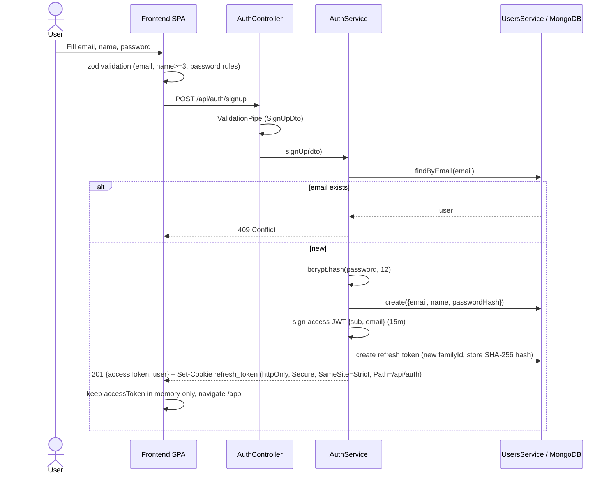
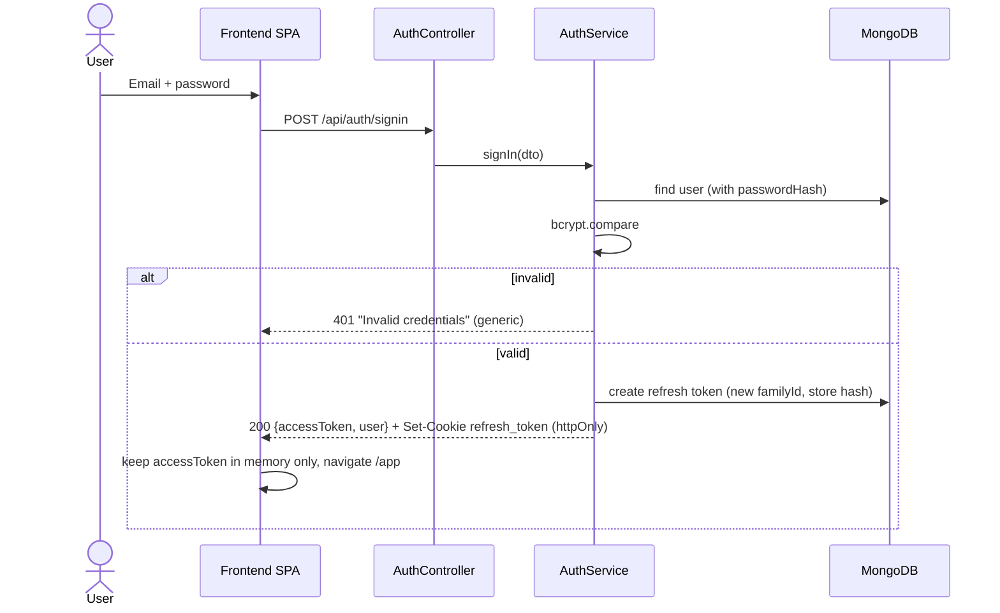
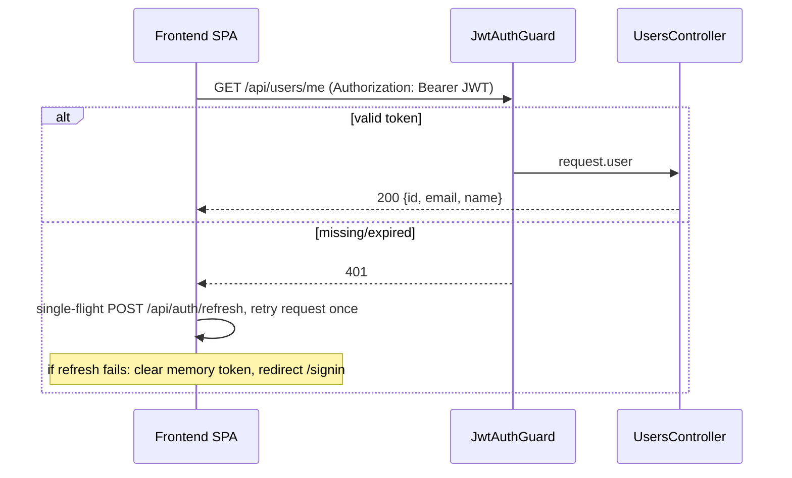
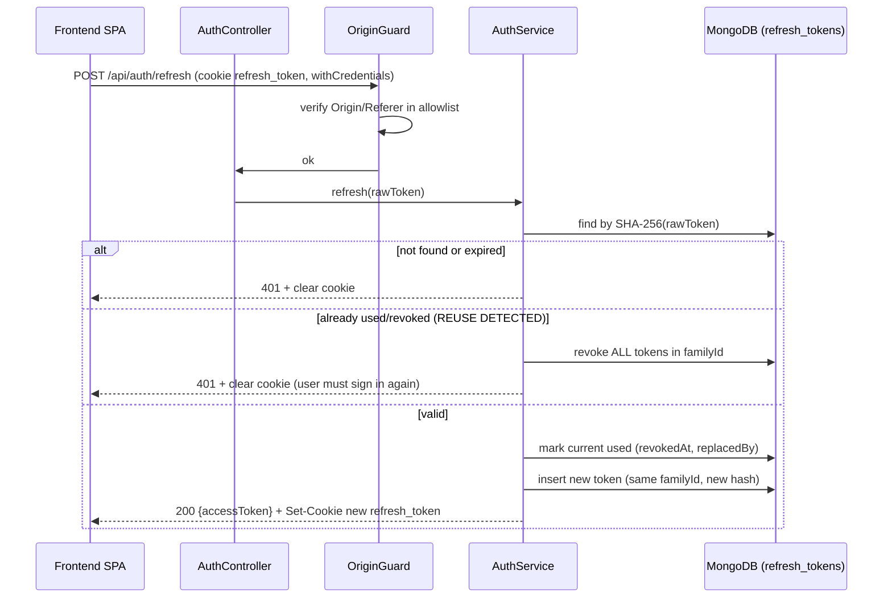
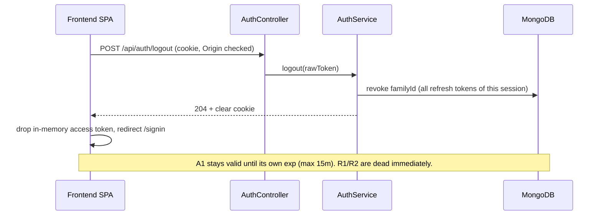
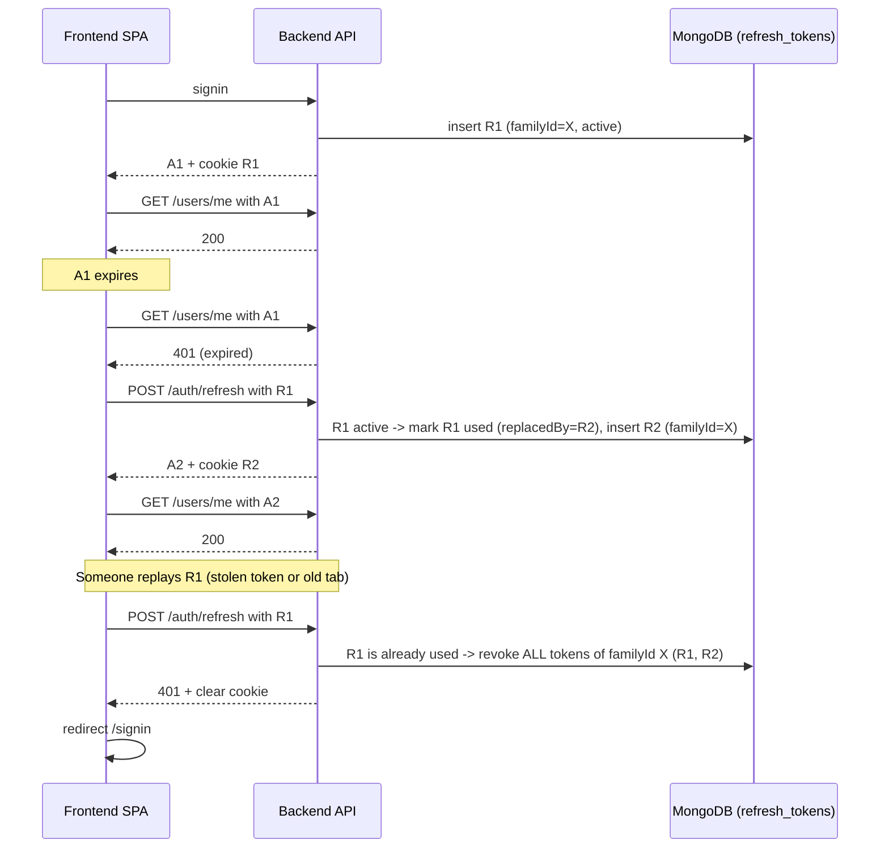

# Authentication Flow

## Sign up

## Sign in

## Protected request and logout

## Token refresh with rotation and reuse detection

## Logout

## Token lifecycle: A1, R1, A2, R2

A = access JWT (15 min, memory only). R = opaque refresh token (httpOnly cookie, hash stored in `refresh_tokens`).

### What happens in each case

| # | Situation | Server decision | Result |
|---|---|---|---|
| 1 | A1 valid, R1 active | No refresh needed | Request succeeds |
| 2 | A1 expired, R1 active | Client gets 401, calls `/auth/refresh` once (single-flight) | Continues at case 3 |
| 3 | Refresh with R1 (active, not expired) | Mark R1 `used`, insert R2 (same family), issue A2 | Client gets A2 + R2, retries original request |
| 4 | After case 3, client or attacker sends R1 again | R1 is `used` -> reuse detected -> revoke whole family | 401, R2 is also dead, user must sign in |
| 5 | After case 3, old A1 is used before its `exp` | A1 is a stateless JWT, signature and exp still valid | Accepted until `exp` (max 15 min). R1 is already rejected |
| 6 | Logout while A1 not yet expired | Revoke family (R1 or R2, whichever is current), clear cookie | Refresh is impossible immediately. A1 still works until `exp` (max 15 min) |
| 7 | Refresh after logout (R1 or R2 replayed) | Token is `revoked` | 401, user must sign in |
| 8 | R expired (7 days sliding, 30 days absolute) | `expiresAt` passed (TTL index also deletes it) | 401, user must sign in |
| 9 | Page reload | A is memory-only and lost, cookie R still present | Bootstrap: `/auth/refresh` (rotation as case 3), then `/users/me` |
| 10 | Two tabs refresh with the same R1 at once | Reuse of R1 within a short grace window (about 10 s) returns an error without revoking the family. Outside the window it is treated as case 4 | Avoids logging out a legitimate user |
| 11 | Password change or `logout-all` | Revoke every family of the user | All sessions end, A tokens expire naturally |

Optional strict logout (case 6): put `familyId` as `sid` in A and have `JwtAuthGuard` check that the family is not revoked (one DB read per request). A1 then dies at logout.

### What the `refresh_tokens` table stores

Raw tokens are never stored, only the SHA-256 hash. This is what blocks R1 after rotation.

| Field | Purpose |
|---|---|
| `userId` | Owner |
| `tokenHash` | SHA-256 of the token (unique index) |
| `familyId` | One per login session, used to revoke all tokens of that session |
| `expiresAt` | TTL index removes expired rows |
| `revokedAt` | Set when used by rotation, or revoked by logout or reuse detection |
| `replacedBy` | Points to the next token (R1 -> R2) |
| `userAgent`, `ip` | Audit |

State of the rows through the scenario:

| Step | R1 | R2 | Can R1 be used? |
|---|---|---|---|
| After signin | active | - | Yes |
| After refresh (A2 issued) | used (`revokedAt` set, `replacedBy`=R2) | active | No (triggers case 4) |
| After R1 replay | revoked | revoked | No |
| After logout (instead of replay) | revoked | revoked | No |
