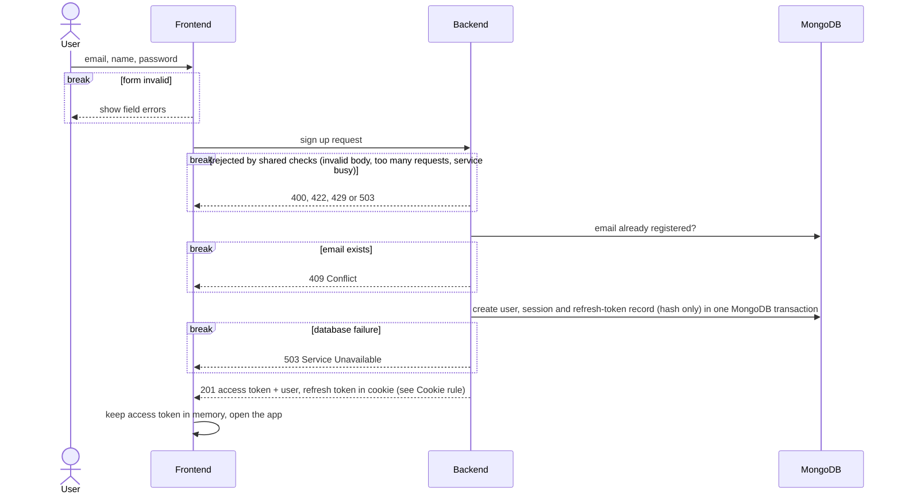
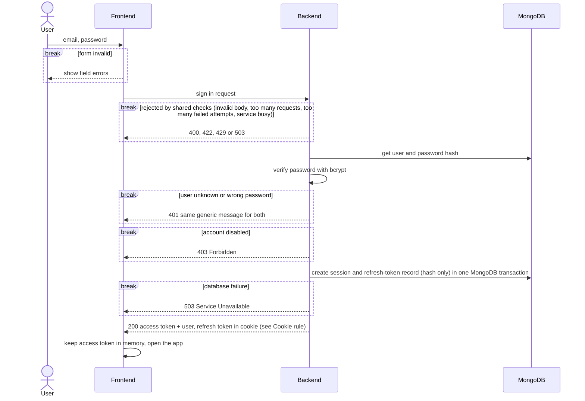
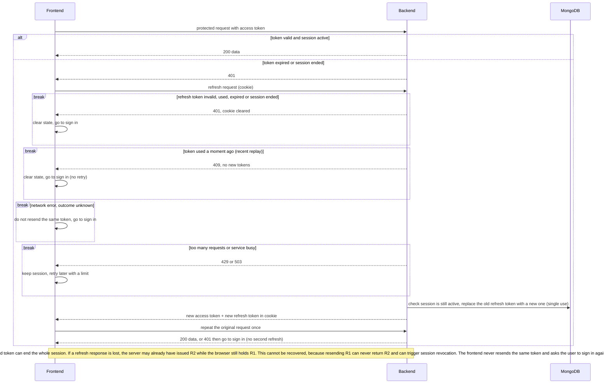
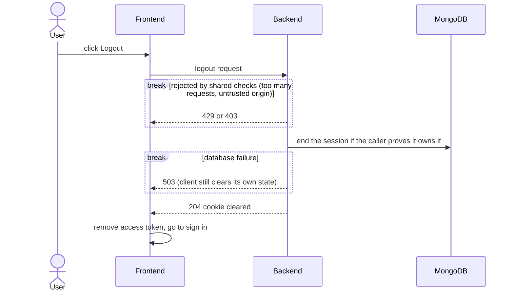

# Authentication Flow (overview)

Technical rules live in `c2-container.md` (platform, deployment and security) and `c3-component.md` (modules, repositories, transactions, request pipeline), and the data model is in `database-design.md`

| # | Flow | Summary |
|---|---|---|
| 1 | Sign up | Create the account, start a session, return tokens |
| 2 | Sign in | Check credentials, start a session, return tokens |
| 3 | Session and refresh | Call protected endpoints, renew tokens when the access token expires |
| 4 | Logout | End the session and clear the cookie |

**Cookie rule (applies to sign up, sign in, refresh and logout):** the refresh token is sent in an HttpOnly, Secure, SameSite=Strict cookie, Path=/api/auth, 7-day expiration. MongoDB stores only its hash. Logout clears the cookie with the same path and attributes.

## 1. Sign up

## 2. Sign in

## 3. Session and refresh

## 4. Logout

