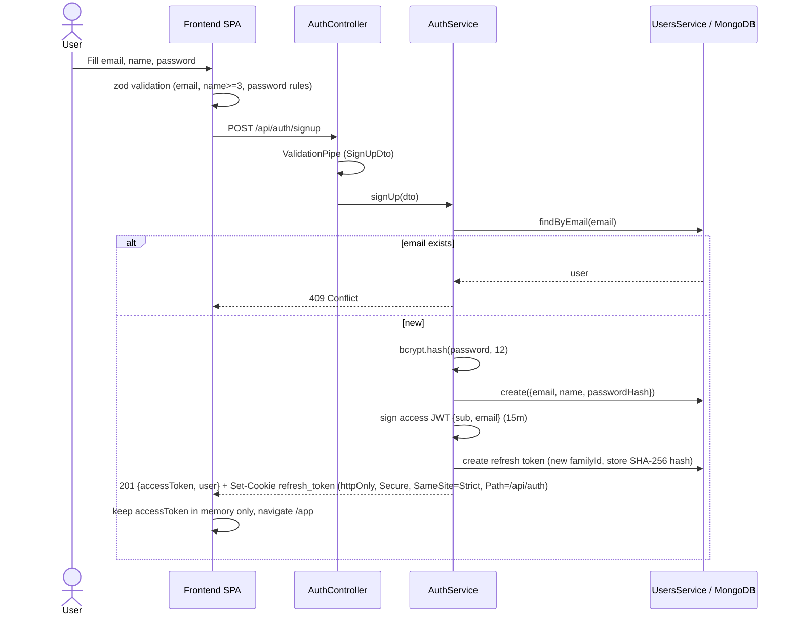
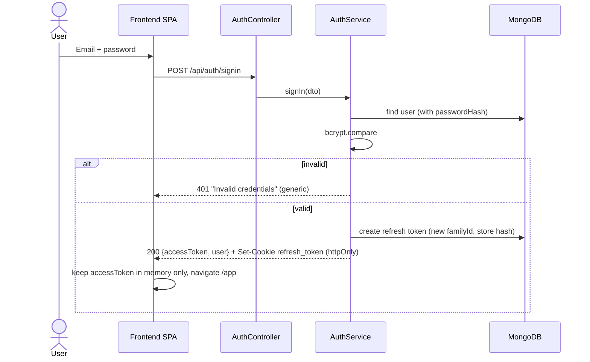
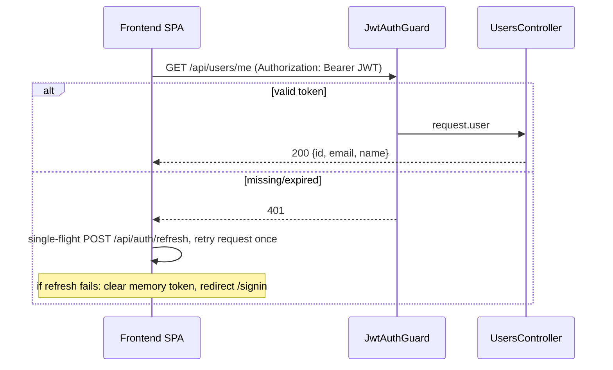
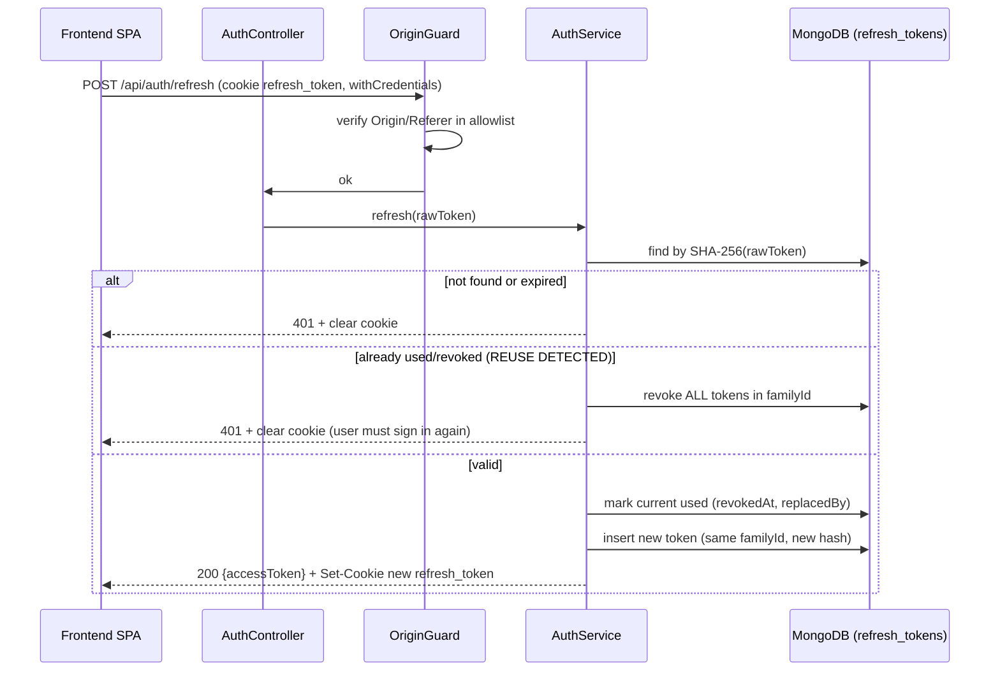
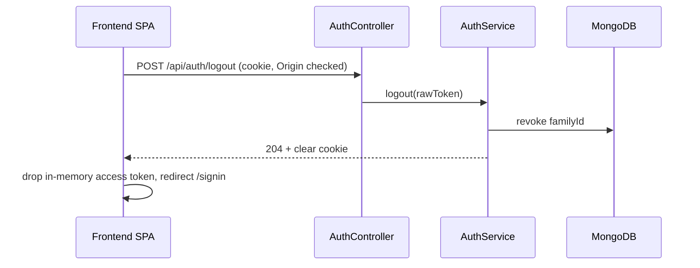

# Authentication Flow

## Sign up

## Sign in

## Protected request and logout

## Token refresh with rotation and reuse detection

## Logout

`POST /api/auth/logout-all` (optional) and password change revoke every family of the user.

## Session bootstrap on page load

The access token is memory-only, so a reload loses it. The SPA calls `POST /api/auth/refresh` first. On success it calls `GET /api/users/me`. On failure it redirects to `/signin`.

## Security notes

- Passwords hashed with bcrypt (cost 12); never returned (`select: false`).
- Same generic error for unknown email and wrong password; rate limiting on auth routes.
- JWT signed with secret from env, short expiry (e.g. 15m–1h); validated by Passport-JWT.
- Helmet, restricted CORS, whitelist `ValidationPipe` (`forbidNonWhitelisted`).
- Token storage: access token in JS memory only (never localStorage/sessionStorage); refresh token in an httpOnly, Secure, SameSite=Strict cookie scoped to `Path=/api/auth`.

## Token model

| Token | Lifetime | Client storage | Transport |
|---|---|---|---|
| Access JWT | 10-15 min | Memory only | `Authorization: Bearer` |
| Refresh token (opaque, 256-bit random) | 7 days sliding, 30 days absolute max | httpOnly cookie | Cookie, auth routes only |

`refresh_tokens` collection: `userId`, `tokenHash` (SHA-256, raw token never stored), `familyId`, `expiresAt` (TTL index), `revokedAt`, `replacedBy`, `userAgent`, `ip`.

## XSS mitigation

- Refresh token is httpOnly, so scripts cannot read it.
- Access token is memory-only and short-lived, which limits the impact of a leak.
- Helmet with a strict CSP; React output escaping; no `dangerouslySetInnerHTML`.
- Residual risk: XSS can still make authenticated calls while the page is open.

## CSRF mitigation

Only the cookie-based endpoints (`/refresh`, `/logout`) are CSRF-relevant. Business endpoints use the Bearer header, which cross-site requests cannot attach.

- `SameSite=Strict` and `Path=/api/auth` on the cookie.
- Strict CORS: exact origin allowlist with `credentials: true`, never `*`.
- `OriginGuard` validates `Origin`/`Referer` on `/refresh` and `/logout`.
- Optional: double-submit CSRF header.
- Dev: Vite (:5173) and API (:3000) are same-site (localhost). In production, serve both under one domain or behind a reverse proxy.

## Config

`JWT_ACCESS_EXPIRES_IN`, `REFRESH_TTL_DAYS`, `REFRESH_ABSOLUTE_TTL_DAYS`, `COOKIE_SECURE`, `CORS_ORIGIN`.

## Required tests

Rotation, reuse detection revokes the family, expired token rejected, logout revokes the family, and concurrent refresh handled by the single-flight client.
