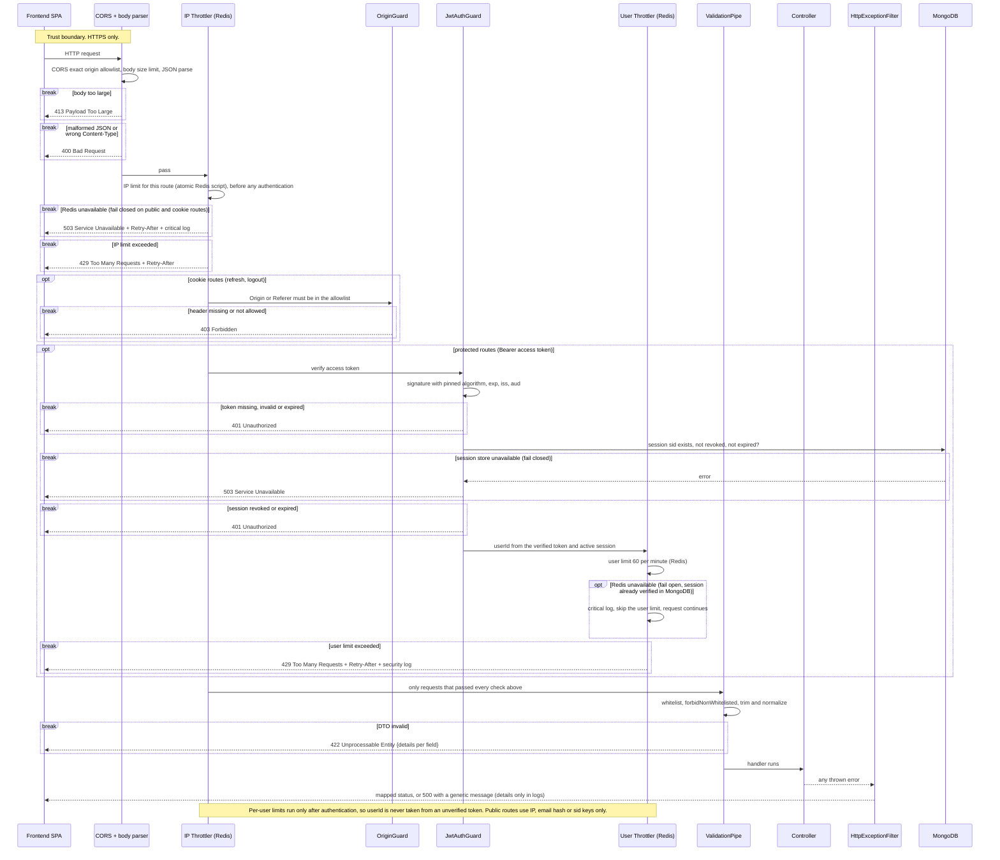
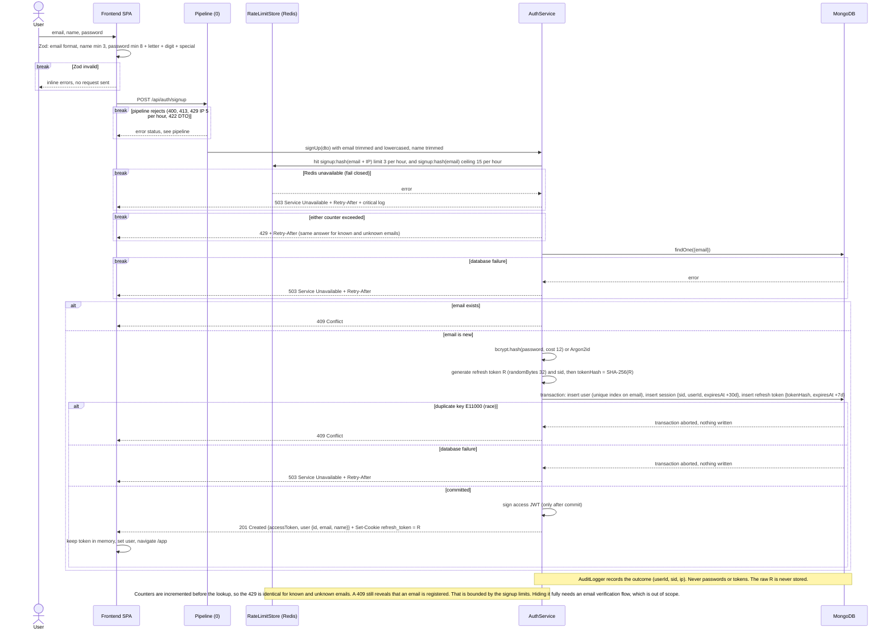
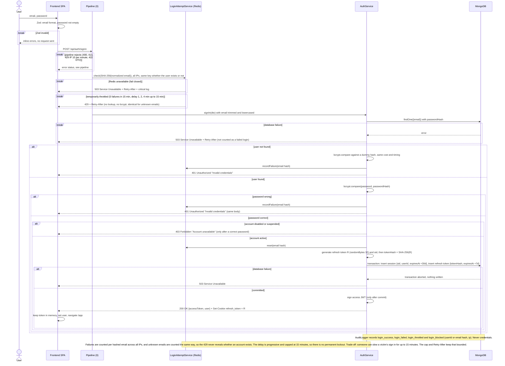
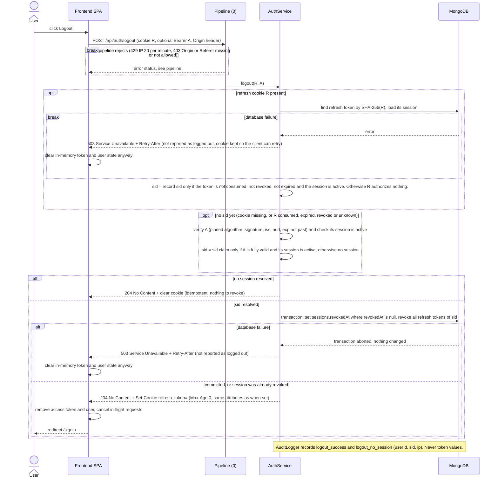
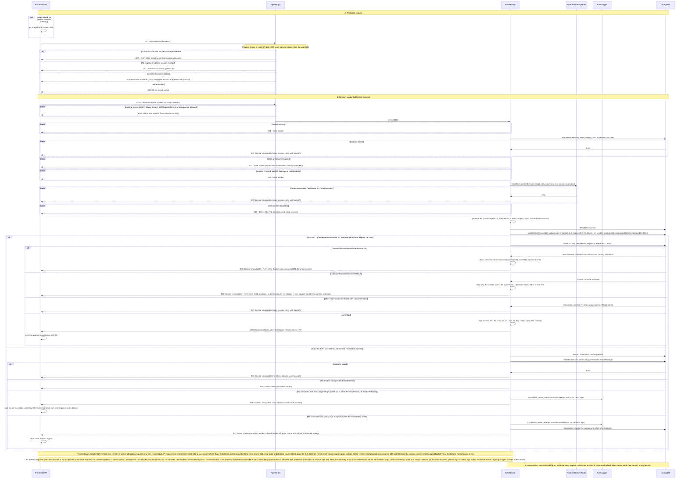

# Authentication Flow

Session model: one `sessions` document per login (`sid`), many `refresh_tokens` per session (rotation). Only SHA-256 hashes of refresh tokens are stored. Consumed and revoked records are kept until their TTL so reuse can be detected.

Diagram convention: a `break` block means the request ends there. Nothing after it runs, and no token is issued.

| # | Diagram | Scope |
|---|---|---|
| 0 | Request pipeline | Checks shared by every endpoint, in order |
| 1 | Sign Up | Create user, session and tokens in one transaction |
| 2 | Sign In | Verify credentials, create session and tokens in one transaction |
| 3 | Logout | Revoke session, clear cookie |
| 4 | Session and refresh | Protected requests, transactional refresh rotation, reuse handling |

## Rate limits

| Route | Key | Limit | Applied |
|---|---|---|---|
| All routes | IP | per route, below | First, before any authentication |
| `POST /auth/signup` | IP | 5 per hour | Pipeline |
| `POST /auth/signup` | SHA-256(normalized email) + IP | 3 per hour | After DTO validation and normalization |
| `POST /auth/signup` | SHA-256(normalized email), all IPs | 15 per hour (safety ceiling) | After DTO validation and normalization |
| `POST /auth/signin` | IP | 10 per minute | Pipeline |
| `POST /auth/signin` | SHA-256(normalized email), all IPs | 5 failures in 15 min, then progressive delay (1, 2, 4 min, max 15 min) | Before the user lookup |
| `POST /auth/logout` | IP | 20 per minute | Pipeline |
| `POST /auth/refresh` | IP | 10 per minute | Pipeline |
| `POST /auth/refresh` | `sid` | 10 per minute | Only after the refresh token resolved a real session |
| Protected routes | `userId` | 60 per minute | Only after JWT and session were verified |

Every limit answers `429 Too Many Requests` with `Retry-After`, and the request stops there. No limit is a permanent lock: all counters are time windows that expire by themselves.

Signup throttling and denial of service. A counter keyed only on the email would let an attacker block a victim from registering with three requests. So the strict counter is keyed on email hash plus IP: an attacker only blocks their own IP for that email. The email-only counter is a high ceiling (15 per hour) that needs several IPs to reach. Signup counters never affect sign in, only requests that passed DTO validation are counted, and every window is one hour at most.

Storage: all counters live in Redis behind the `RateLimitStore` interface. Redis is shared by every backend instance, so limits are exact however many instances run, and counters survive a backend restart.

- Every hit is one atomic Lua script (`INCR`, then `EXPIRE` on first hit, returns count and TTL), so concurrent requests cannot race. `Retry-After` comes from the key TTL.
- Key format: `rl:{route}:{type}:{value}`, where the value is the IP, the SHA-256 email hash, the email hash plus IP, the `sid` or the `userId`. Raw emails are never stored. Sign in failures use a counter plus a `blockedUntil` key with a TTL (1, 2, 4 min, max 15 min).
- Every key has a TTL, so nothing is permanent and no cleanup job is needed.
- Redis holds only rate-limit data. Sessions, refresh tokens and users stay in MongoDB, and rotation, reuse detection and revocation never depend on Redis.
- Redis unavailable (short command timeout, then): sign up, sign in, logout and refresh fail closed with `503` + `Retry-After`, so brute force protection is never silently off. The per-user limit on protected routes fails open with a critical log, because the session is still verified in MongoDB. Every outage is logged and alerted.
- Redis needs a password and a private network only (no public port). Local setup: one `redis` service in docker-compose.
- The in-memory implementation remains available for unit tests (`RATE_LIMIT_STORE=memory`). Default is `redis`.

## MongoDB and token rules

- Transactions need a replica set (Atlas, or a single-node replica set in local Docker). Signup, sign in, rotation and revocation each use one transaction.
- Transaction errors: use the driver's transaction helper semantics. `TransientTransactionError` means nothing was committed, so the whole transaction may be retried (max 2). `UnknownTransactionCommitResult` means the commit may or may not have applied, so only the commit is retried (max 2, time limited), never the body. If still unknown, return 503 and issue no tokens. A later refresh with R1 then either finds it unconsumed (rotation runs normally) or consumed (reuse policy applies, no tokens). Other errors are treated as failed and aborted. Signup, sign in, logout and revocation follow the same rules, and the unique index on email plus the conditional `updateOne` keep retries idempotent.
- Refresh token creation order: generate the random 256-bit token R first, compute `tokenHash = SHA-256(R)`, store only the hash, and send R only in the cookie. The access JWT is signed after the transaction commits.
- Access JWT: `{sub, sid, iss, aud, iat, exp +15m}`, algorithm pinned, kept in memory only.
- Cookie `refresh_token`: HttpOnly, Secure, SameSite=Strict, Path=/api/auth, Max-Age 7d. Session capped at 30 days.

## Refresh reuse policy

Every presentation of a consumed token is logged as `refresh_reuse_attempt` (sid, ip, user agent hash, token age, outcome). A consumed token never gets new tokens, in any case below.

| Presented token state | Action on the session | Response |
|---|---|---|
| Cookie missing or token unknown | None (cannot be attributed to a session) | 401 + clear cookie |
| Token expired, never consumed | None (normal expiry) | 401 + clear cookie |
| Session revoked, past the 30 day cap, or user disabled | None (session already dead) | 401 + clear cookie |
| Token revoked (for example by logout) | None (session already revoked) | 401 + clear cookie |
| Consumed less than 10 s ago, same IP and user agent hash as the request that consumed it, and at most 3 attempts | None (benign concurrent tab or lost response) | 409 + `Retry-After: 1`, no tokens |
| Consumed less than 10 s ago, but a different IP or user agent hash, or more than 3 attempts | Revoke session and all its tokens | 401 + clear cookie |
| Consumed 10 s ago or more | Revoke session and all its tokens | 401 + clear cookie |

The 10 s same-IP and user-agent window is only a heuristic for concurrent tabs and lost responses. A matching IP and user agent hash does not prove the caller is legitimate, since both can be copied by an attacker. So the benign branch gives no tokens, only a 409 telling the client to wait, and the attempt cap (3) bounds it. Consumed tokens never issue new tokens in any branch.

If the revocation transaction fails, the response is still 401 with no tokens, a critical log is written, and the next presentation of the consumed token takes the same path and retries the revocation.

## 0. Request pipeline (shared)

## 1. Sign Up

## 2. Sign In

## 3. Logout

Logout is authorized only by an active refresh credential (hash found, not consumed, not revoked, not expired, session active) or a fully verified, unexpired access JWT whose session is active. A consumed, expired or revoked refresh token alone never authorizes a revocation. In that case the server falls back to the access token, and if that is not valid either it only clears the cookie (204, nothing revoked, logged as `logout_no_session`). The client always clears its own state.

## 4. Session and refresh

