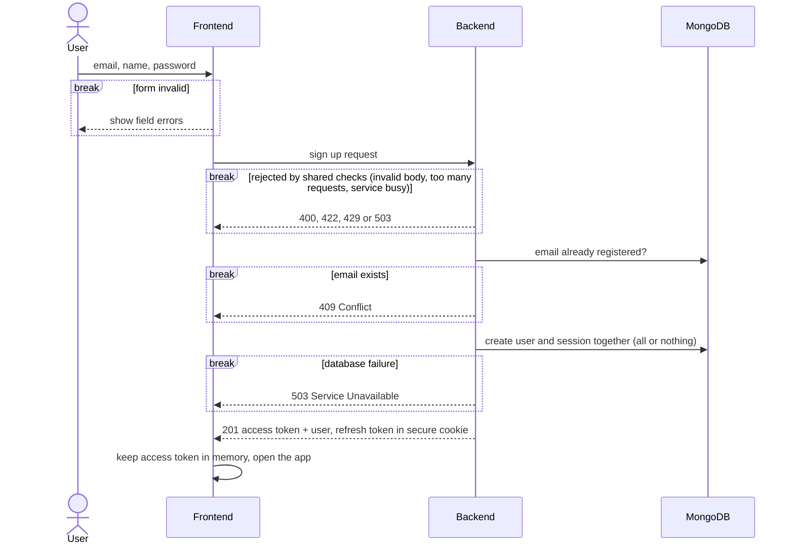
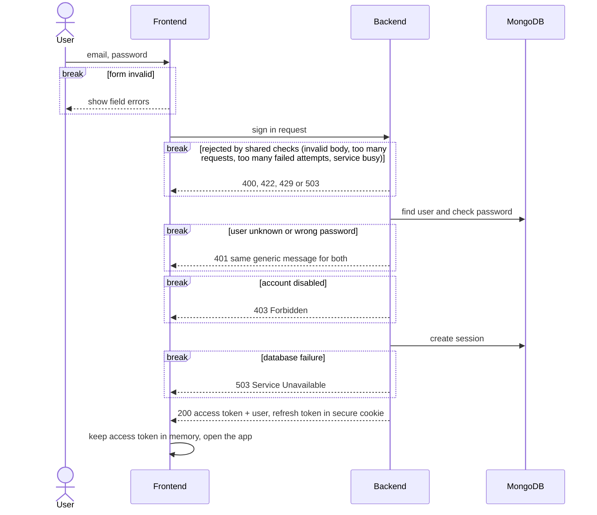
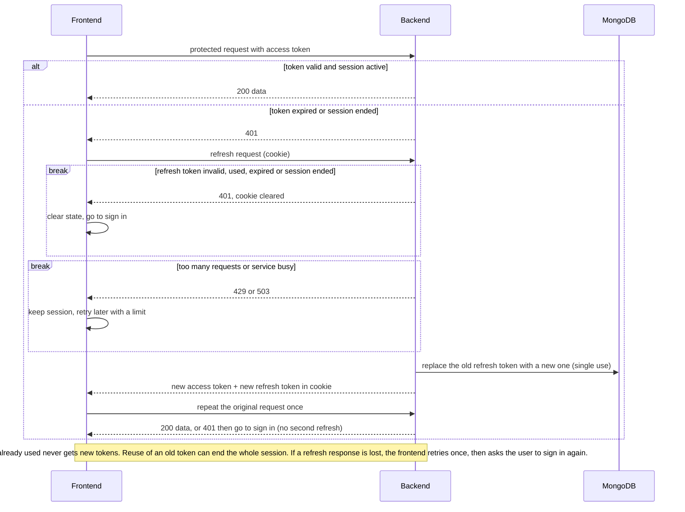
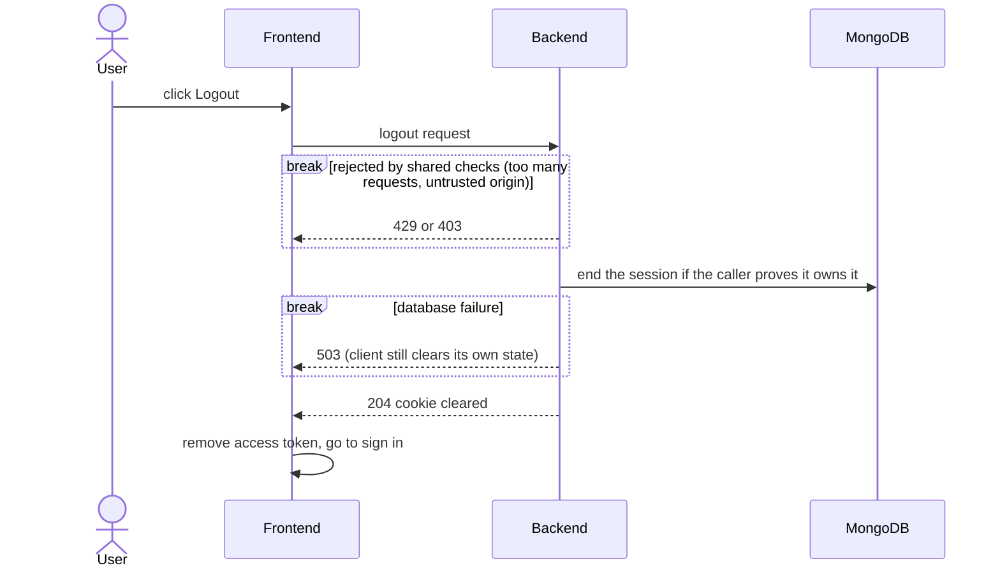

# Authentication Flow (overview)

What the system does, at a high level. Technical rules live in the C4 docs: `c2-container.md` (platform and security settings), `c3-component.md` (components and request pipeline), `c4-code.md` (classes, data, detailed rules).

Conventions: a `break` block means the request ends there. Every request first passes the shared checks (HTTPS, CORS, size limit, rate limit, validation). Details in `c3-component.md`.

| # | Flow | Summary |
|---|---|---|
| 1 | Sign up | Create the account, start a session, return tokens |
| 2 | Sign in | Check credentials, start a session, return tokens |
| 3 | Session and refresh | Call protected endpoints, renew tokens when the access token expires |
| 4 | Logout | End the session and clear the cookie |

Tokens in one line: a short-lived access token kept in browser memory, and a rotating refresh token kept in a secure cookie. A used refresh token is never accepted again.

## 1. Sign up

## 2. Sign in

## 3. Session and refresh

## 4. Logout

## What we implement, in levels

| Level | Scope |
|---|---|
| 1 | Sign up, sign in, protected "welcome" endpoint, validation, error handling |
| 2 | Refresh tokens with rotation, logout, secure cookie, session checks |
| 3 | Rate limiting (Redis), audit logging, reuse detection |
| 4 | Tests, API docs, hardening from the C4 docs |

Security goals: no tokens in localStorage, no raw refresh tokens stored, no user enumeration beyond the sign up conflict, no permanent lockouts, and failures never issue tokens.
