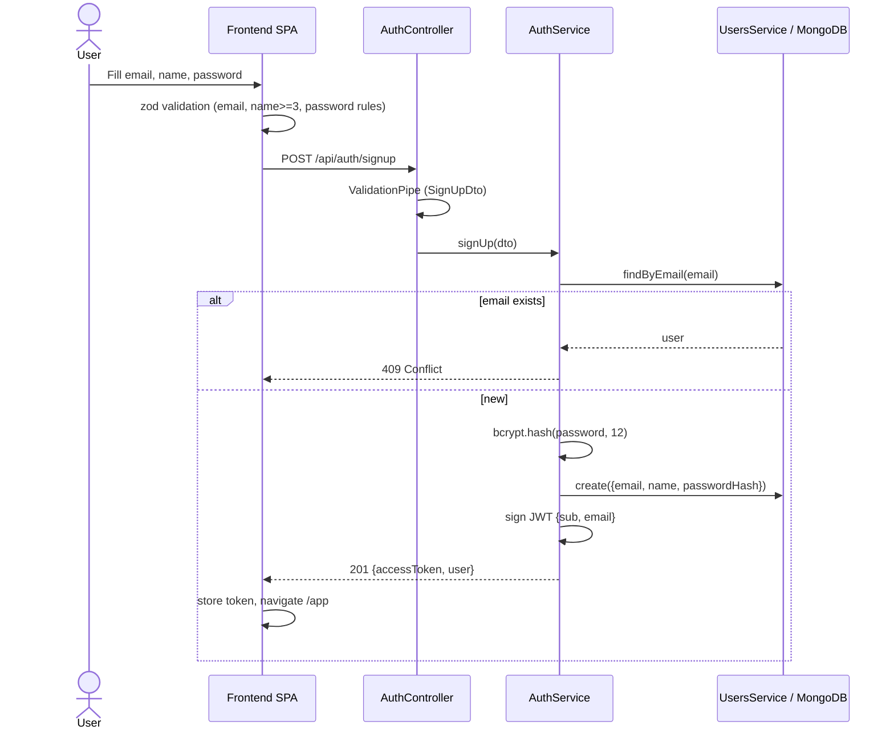
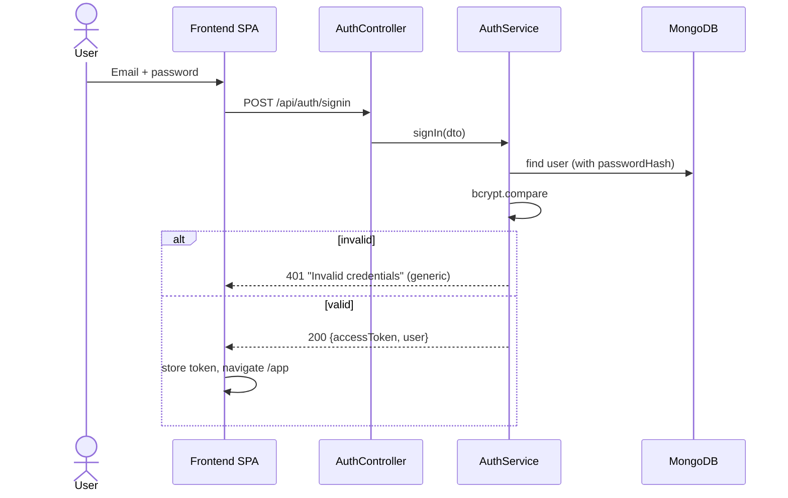
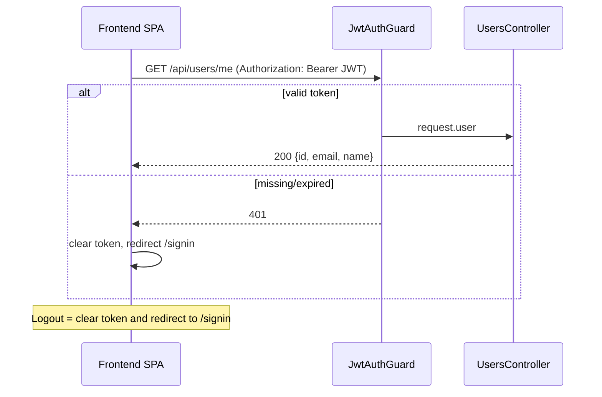

# Authentication Flow

## Sign up

## Sign in

## Protected request and logout

## Security notes

- Passwords hashed with bcrypt (cost 12); never returned (`select: false`).
- Same generic error for unknown email and wrong password; rate limiting on auth routes.
- JWT signed with secret from env, short expiry (e.g. 15m–1h); validated by Passport-JWT.
- Helmet, restricted CORS, whitelist `ValidationPipe` (`forbidNonWhitelisted`).
- Token storage: in-memory + sessionStorage for simplicity; production hardening option is an httpOnly, SameSite cookie.
