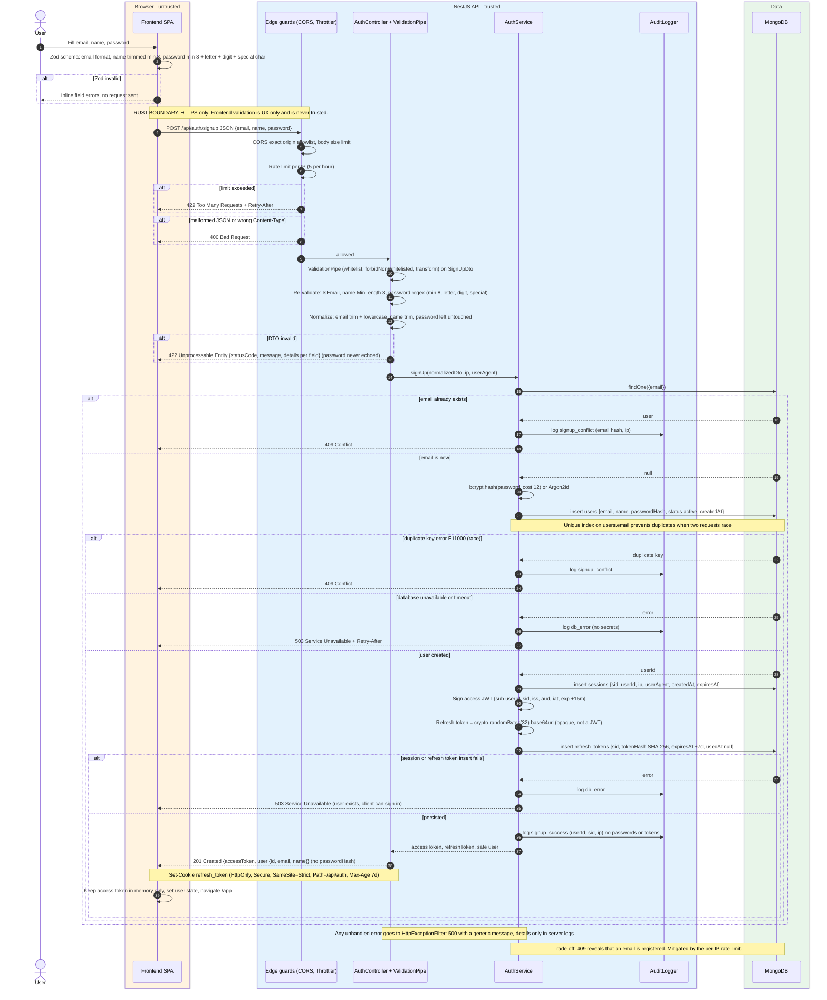
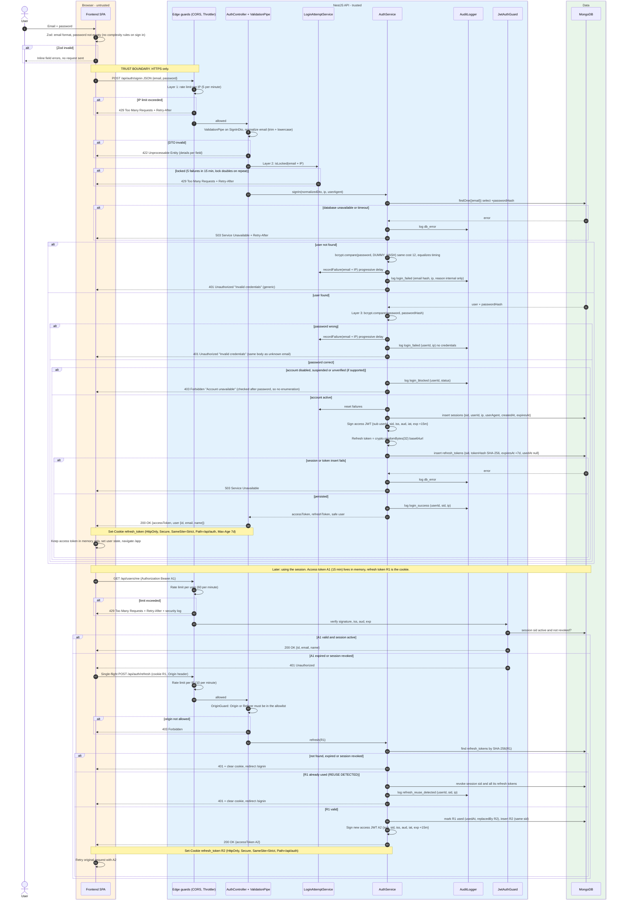
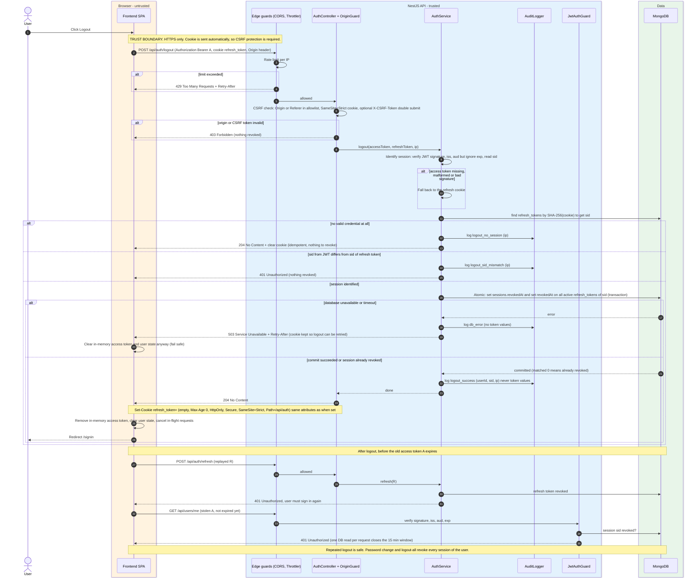

# Authentication Flow

Three flows: Sign Up, Sign In, Logout. Session model: one `sessions` document per login (`sid`), many `refresh_tokens` per session (rotation). Only SHA-256 hashes of refresh tokens are stored.

## Sign Up

## Sign In

## Logout

