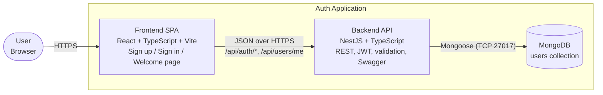

# C2 – Container Diagram

| Container | Tech | Responsibility |
|---|---|---|
| Frontend SPA | React, TypeScript, Vite, react-hook-form, zod, React Router | Forms + client validation, token storage, route guarding |
| Backend API | NestJS, class-validator, Passport-JWT, bcrypt, Helmet, Throttler | Sign up/in, JWT issuing, protected endpoints, logging, error handling |
| MongoDB | MongoDB 7 via Mongoose | Persists users (unique email index, hashed password) |
