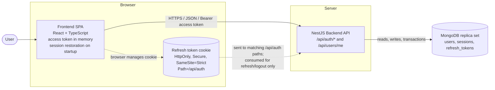

# C2: Container Diagram

## Containers

| Container | Responsibility |
|---|---|
| Frontend SPA | Form validation, keeps the access token in memory only, retries a failed request once after refresh, goes to sign in on failure. On application startup, attempts session restoration using the refresh cookie, then loads the user profile (`GET /api/users/me`), so a browser reload doesn't log the user out |
| Backend API | Validation, rate limiting, origin check, password hashing (bcrypt), token issuing and rotation, session checks |
| MongoDB | Stores `users`, `sessions` and `refresh_tokens` (see `database-design.md`). A replica set is required for transactions |

## Endpoints

| Method | Path | Auth | Success |
|---|---|---|---|
| POST | `/api/auth/signup` | none | 201 |
| POST | `/api/auth/signin` | none | 200 |
| POST | `/api/auth/refresh` | refresh cookie | 200 |
| POST | `/api/auth/logout` | refresh cookie or access token | 204 |
| GET | `/api/users/me` | Bearer access token | 200 |

The refresh cookie is attached by the browser to every matching `/api/auth` request, including signup and signin. The backend consumes it only for refresh and logout.
