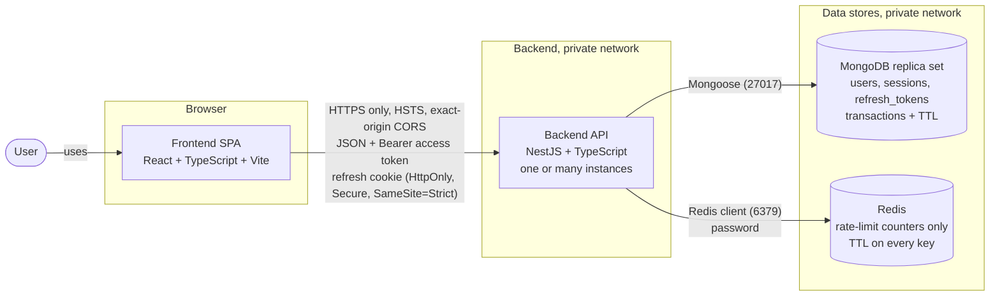
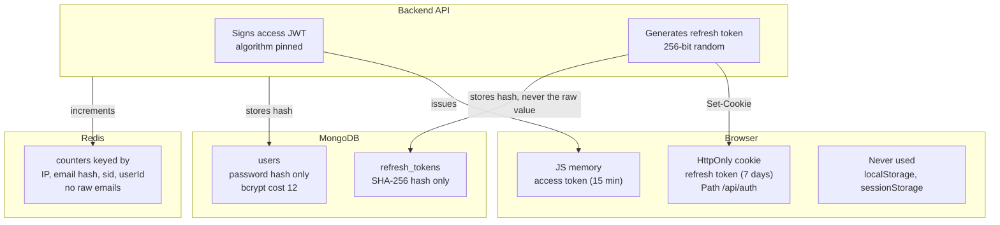
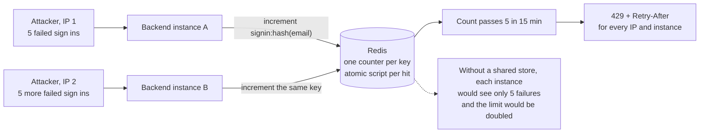
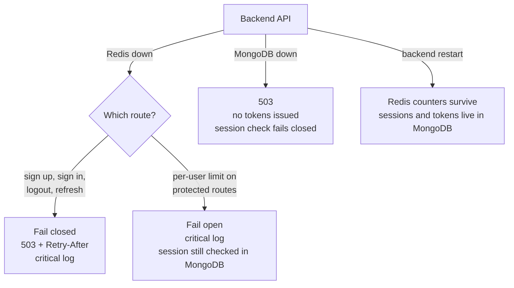

# C2 – Container Diagram

System level only: what runs, how containers talk, where secrets live, what happens when a container fails. Internals of the backend and frontend are in `c3-component.md`.

## 1. Containers

## 2. Where each secret lives

## 3. Why Redis: shared counters across instances

## 4. Failure behavior

