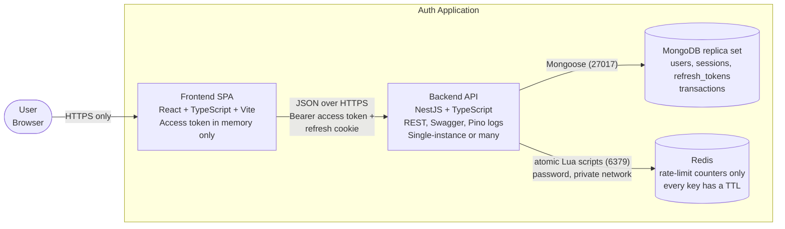

# C2 – Container Diagram

## Platform and security settings

| Area | Setting |
|---|---|
| Transport | HTTPS only, HSTS, exact-origin CORS allowlist |
| Access token | JWT `{sub, sid, iss, aud, iat, exp +15m}`, algorithm pinned, memory only |
| Refresh token | Random 256-bit opaque value, only its SHA-256 hash is stored, 7 day expiry, session capped at 30 days |
| Refresh cookie | `refresh_token`, HttpOnly, Secure, SameSite=Strict, Path=/api/auth, Max-Age 7d |
| CSRF | SameSite=Strict plus an Origin/Referer allowlist on cookie routes (refresh, logout) |
| Passwords | bcrypt cost 12 (or Argon2id), never logged |
| MongoDB | Replica set required (Atlas, or single-node replica set in local Docker) for transactions |
| Redis | Holds rate-limit data only. Password, private network, no public port. Default store, memory store for unit tests |

## Rate limits (stored in Redis)

| Route | Key | Limit |
|---|---|---|
| All routes | IP | per route, below, applied first |
| Sign up | IP | 5 per hour |
| Sign up | email hash + IP | 3 per hour |
| Sign up | email hash, all IPs | 15 per hour (ceiling) |
| Sign in | IP | 10 per minute |
| Sign in | email hash, all IPs | 5 failures in 15 min, then delay 1, 2, 4 min, max 15 min |
| Logout | IP | 20 per minute |
| Refresh | IP | 10 per minute |
| Refresh | `sid` | 10 per minute, only after the session is resolved |
| Protected routes | `userId` | 60 per minute, only after token and session are verified |

All limits answer 429 with `Retry-After` and expire by themselves, so nothing is a permanent lock.

## Failure behavior

| Dependency down | Behavior |
|---|---|
| Redis | Sign up, sign in, logout and refresh fail closed (503 + `Retry-After`, critical log). The per-user limit on protected routes fails open with a critical log, because the session is still verified in MongoDB |
| MongoDB | Session check fails closed: 503. No tokens are issued on any database failure |
| Redis or MongoDB restart | Redis counters survive backend restarts. Sessions and tokens live in MongoDB |
