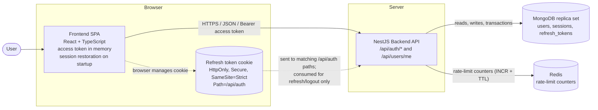

# C2: Container Diagram

## Containers

| Container | Responsibility |
|---|---|
| Frontend SPA | Form validation, keeps the access token in memory only, retries a failed request once after refresh, goes to sign in on failure. On application startup, attempts session restoration using the refresh cookie, then loads the user profile (`GET /api/users/me`), so a browser reload doesn't log the user out |
| Backend API | Validation, rate limiting, origin check, password hashing (bcrypt), token issuing and rotation, session checks |
| MongoDB | Stores `users`, `sessions` and `refresh_tokens` (see `database-design.md`). A replica set is required for transactions |
| Redis | Shared rate-limit counters (general per-IP limit and failed sign-in limit) so limits hold across several backend instances. Keys expire by TTL. Failed sign-ins are counted per IP (5) and per email (10, hashed) per 15 minutes. If Redis is unavailable the failed sign-in limiter falls back to a per-instance in-memory counter and the general throttler fails open, both logging a warning; authentication data is never stored in Redis |
