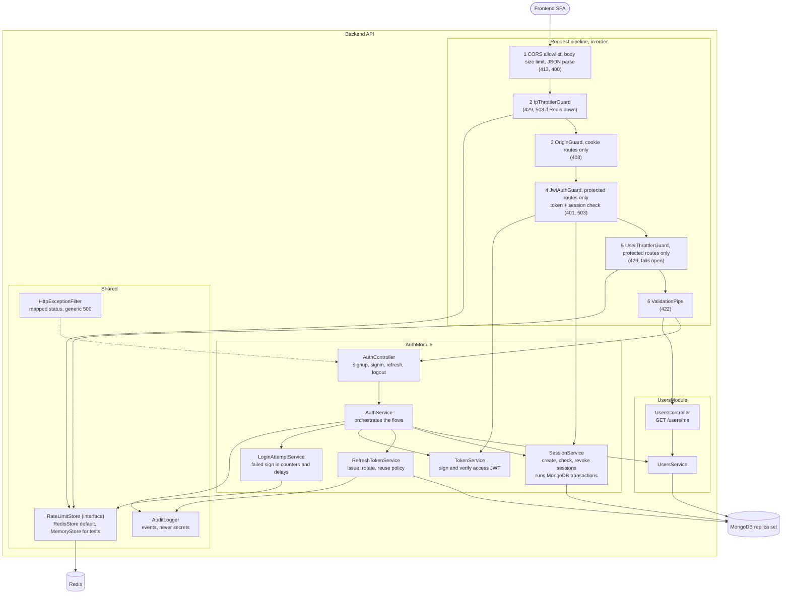
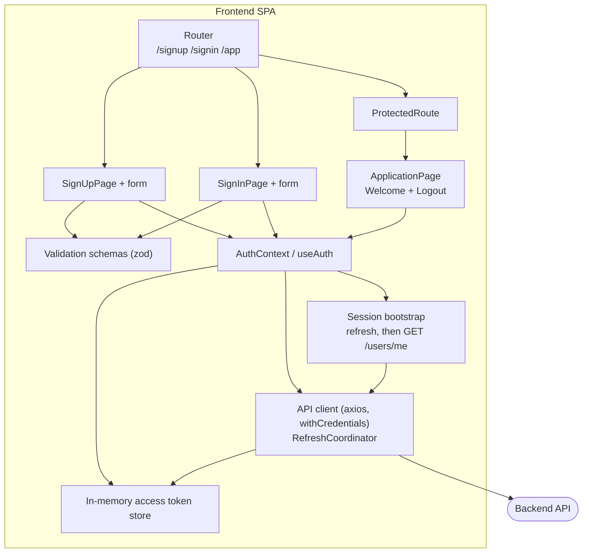

# C3 – Component Diagram

## Backend API (NestJS)

## Responsibilities

| Component | Responsibility |
|---|---|
| Request pipeline | The same ordered checks for every endpoint. Per-user limits run only after authentication, so `userId` is never taken from an unverified token |
| AuthService | Runs sign up, sign in, refresh and logout. No database details inside |
| SessionService | One session per login. Starts, checks and revokes sessions. Owns the MongoDB transactions and their retry rules |
| RefreshTokenService | Creates tokens (random value first, then hash), rotates them in one transaction, applies the reuse policy |
| TokenService | Signs the access JWT only after the transaction commits. Verifies signature, algorithm, `iss`, `aud`, `exp` |
| LoginAttemptService | Counts failed sign ins per email hash, applies the progressive delay. Unknown emails are counted the same way |
| RateLimitStore | One interface for all counters. Redis is the default, memory is for tests |
| AuditLogger | Records sign up, sign in success and failure, throttling, logout, refresh reuse and Redis or commit outages |

## Frontend SPA (React)

| Component | Responsibility |
|---|---|
| RefreshCoordinator | One refresh at a time (single-flight). Each request is retried at most once after a refresh. A 401 from refresh means sign in again, with no more refresh attempts |
| Error handling | 429 and 503 keep the session and retry with capped backoff. A lost refresh response gets one retry, then a "please sign in" message |
