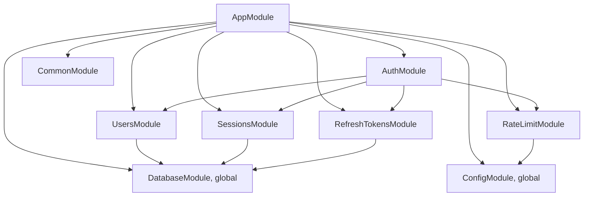
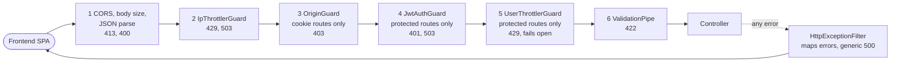
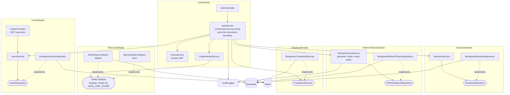
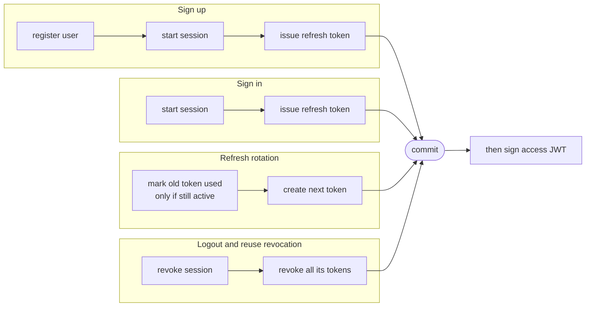
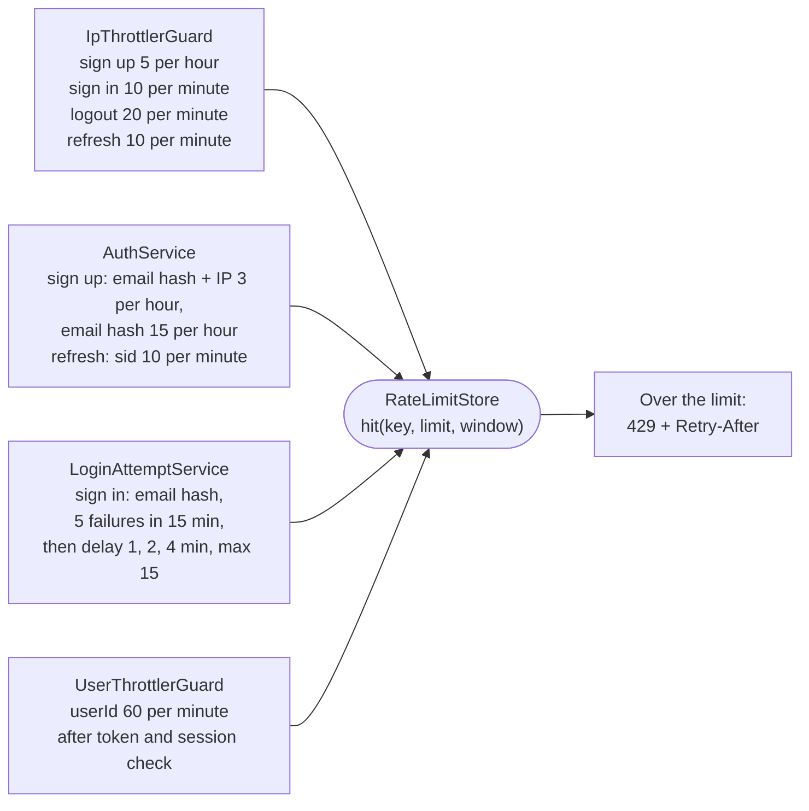
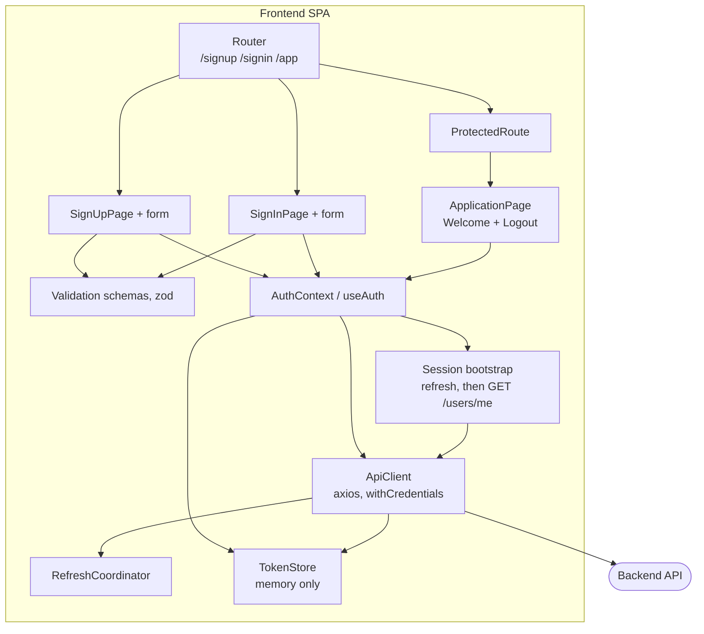
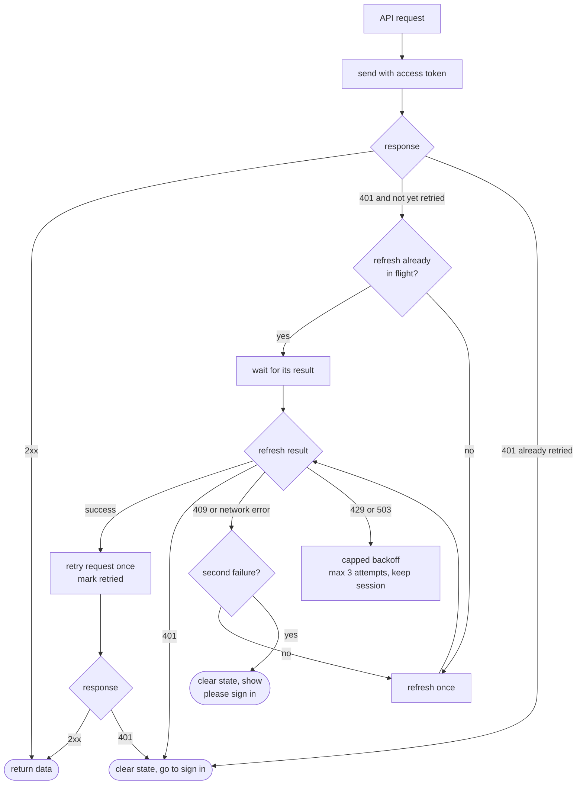

# C3 – Component Diagram

Inside the backend and the frontend: modules, components, request pipeline, rate-limit numbers. System-level topology, secrets and failure behavior are in `c2-container.md`.

## 1. Backend modules and imports

Feature-based modules. Only `AuthModule` combines them. No cycles.

## 2. Request pipeline

## 3. Backend components

Dependency direction: controller, then service, then repository interface. The Mongoose class implements the interface.

## 4. Transaction boundary per flow

`AuthService` opens one transaction through `TransactionRunner`. Each repository write joins it. The access JWT is signed only after the commit.

## 5. Which component enforces which limit

## 6. Frontend components

## 7. RefreshCoordinator behavior

