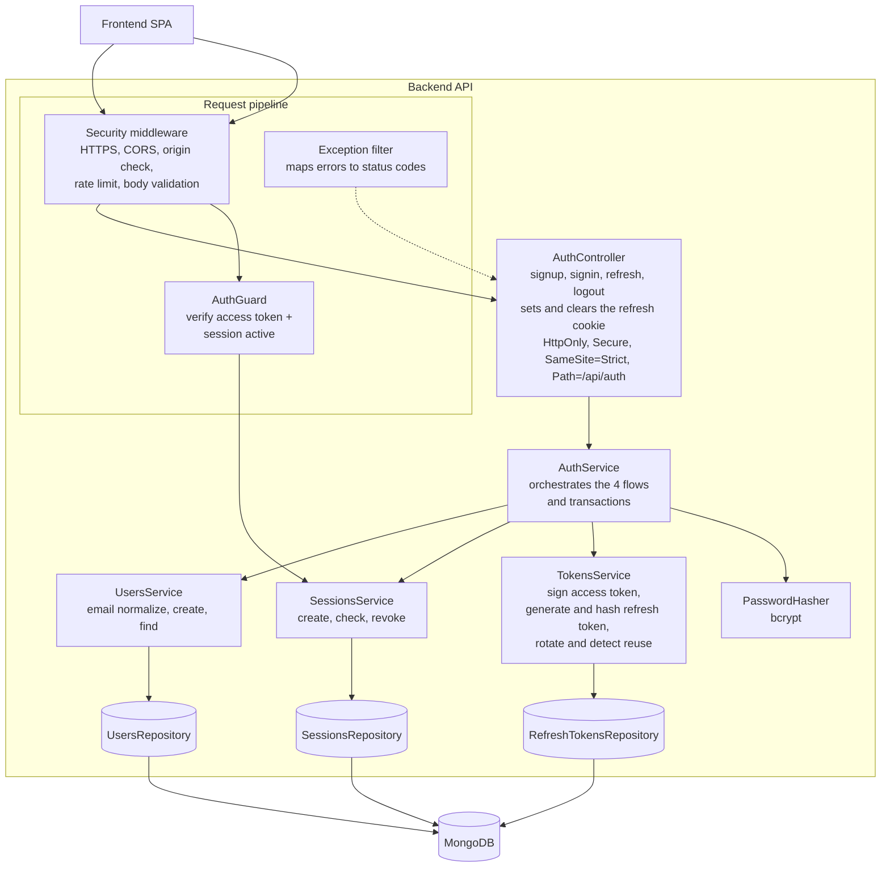
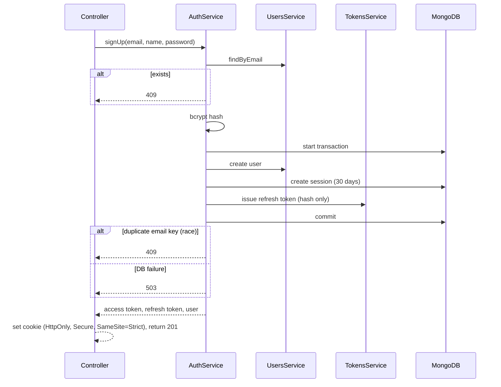
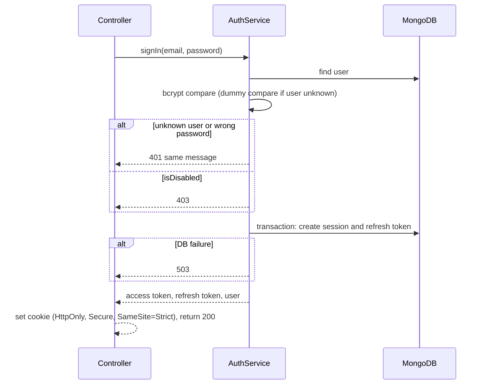
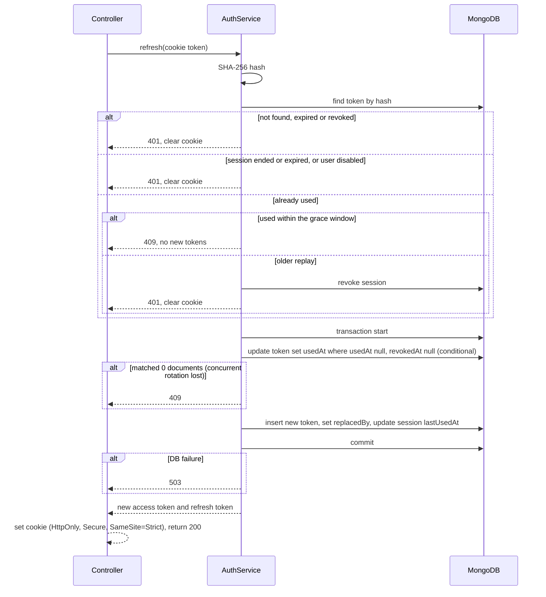
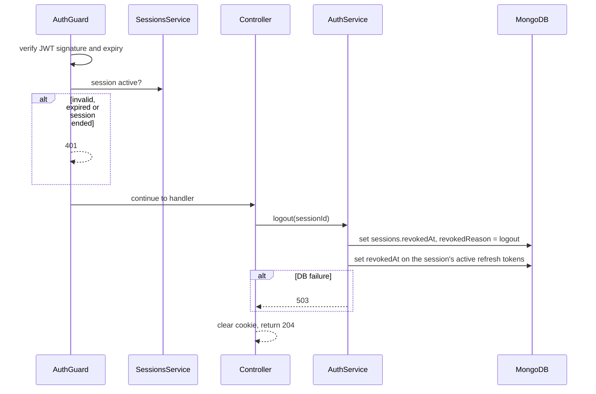

# C3: Component Diagram

## Components

| Component | Responsibility |
|---|---|
| Security middleware | Rate limit (429), body validation (400/422), origin check on refresh and logout (403) |
| AuthGuard | Verifies the access token and that its session is active and not expired. Otherwise 401 |
| AuthController | HTTP only. Reads the refresh cookie, calls `AuthService`, sets or clears the cookie with HttpOnly, Secure, SameSite=Strict, Path=/api/auth (same attributes when clearing) |
| AuthService | Runs each flow and owns the transaction boundary |
| UsersService / Repository | Trim and lowercase email, unique index, find by email |
| SessionsService / Repository | Create (30 days), check active, revoke |
| TokensService / RefreshTokensRepository | Random token, SHA-256 hash, 7 days or session expiry, rotation, reuse detection |
| PasswordHasher | bcrypt hash and compare |
| Exception filter | Single place that maps errors to status codes and a generic body |

## Sign up

## Sign in

## Refresh (rotation)

## Protected request and logout

