# C4 – Code-Level Design

## 1. SOLID applied pragmatically

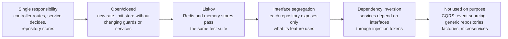

## 2. Backend classes

```mermaid
classDiagram
    class AuthController {
        +signUp(dto)
        +signIn(dto)
        +refresh(req, res)
        +logout(req, res)
    }
    class AuthService {
        +signUp(dto, meta) AuthSession
        +signIn(dto, meta) AuthSession
        +refresh(rawToken, meta) AuthSession
        +logout(rawToken, accessToken) void
    }
    class UsersService {
        +register(dto, tx) User
        +verifyCredentials(email, password) User
        +findById(id) User
    }
    class SessionsService {
        +start(userId, tx) Session
        +isActive(sid) boolean
        +revoke(sid, tx) void
    }
    class RefreshTokensService {
        +issue(sid, tx) RawToken
        +rotate(rawToken, meta) RotationResult
        +revokeAllForSession(sid, tx) void
    }
    class TokenService {
        +signAccess(userId, sid) string
        +verifyAccess(token) Claims
    }
    class LoginAttemptService {
        +check(emailHash) void
        +recordFailure(emailHash) void
        +reset(emailHash) void
    }
    class AuditLogger {
        +log(event, fields) void
    }

    class UsersRepository {
        <<interface>>
        +findByEmail(email) User
        +findById(id) User
        +create(data, tx) User
    }
    class SessionsRepository {
        <<interface>>
        +create(data, tx) Session
        +findById(sid) Session
        +revoke(sid, tx) void
    }
    class RefreshTokensRepository {
        <<interface>>
        +create(data, tx) RefreshToken
        +findByHash(hash) RefreshToken
        +markUsedIfActive(hash, meta, replacedBy, tx) boolean
        +incrementReuseAttempts(id) int
        +revokeAllBySid(sid, tx) void
    }
    class TransactionRunner {
        <<interface>>
        +run(work) T
    }
    class RateLimitStore {
        <<interface>>
        +hit(key, limit, windowSec) HitResult
    }

    class MongooseUsersRepository
    class MongooseSessionsRepository
    class MongooseRefreshTokensRepository
    class MongooseTransactionRunner
    class RedisRateLimitStore
    class MemoryRateLimitStore

    AuthController --> AuthService
    AuthService --> UsersService
    AuthService --> SessionsService
    AuthService --> RefreshTokensService
    AuthService --> TokenService
    AuthService --> LoginAttemptService
    AuthService --> TransactionRunner
    AuthService --> AuditLogger
    RefreshTokensService --> AuditLogger
    UsersService --> UsersRepository
    SessionsService --> SessionsRepository
    RefreshTokensService --> RefreshTokensRepository
    LoginAttemptService --> RateLimitStore
    MongooseUsersRepository ..|> UsersRepository
    MongooseSessionsRepository ..|> SessionsRepository
    MongooseRefreshTokensRepository ..|> RefreshTokensRepository
    MongooseTransactionRunner ..|> TransactionRunner
    RedisRateLimitStore ..|> RateLimitStore
    MemoryRateLimitStore ..|> RateLimitStore
```

## 3. Dependency injection tokens

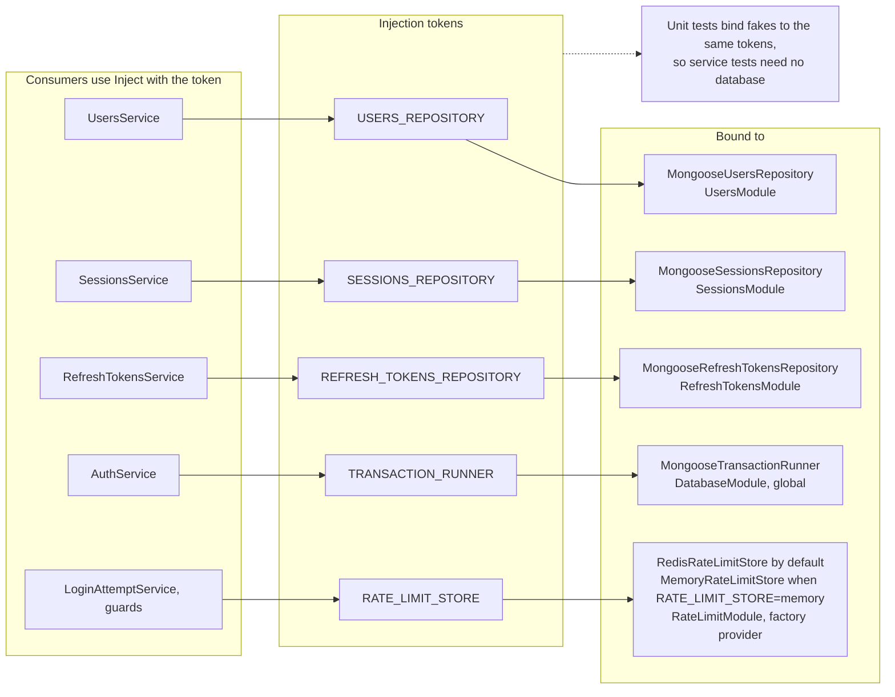

## 4. Data model

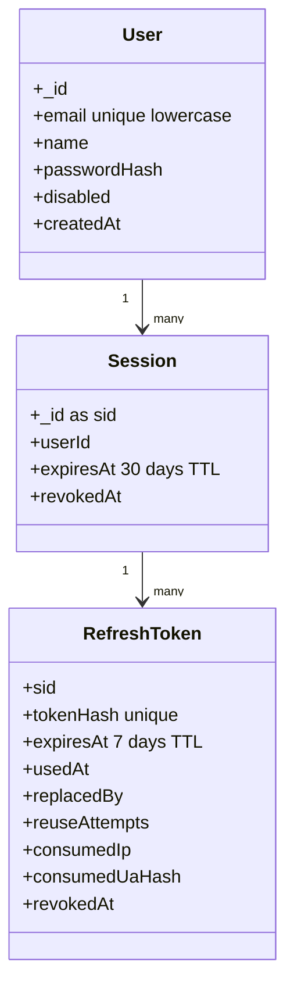

## 5. Transaction boundary

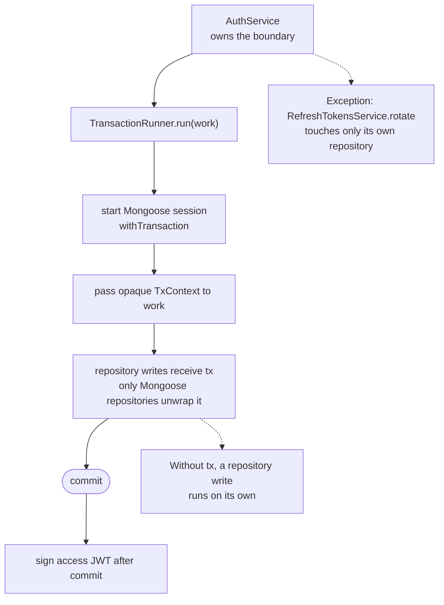

## 6. Transaction errors

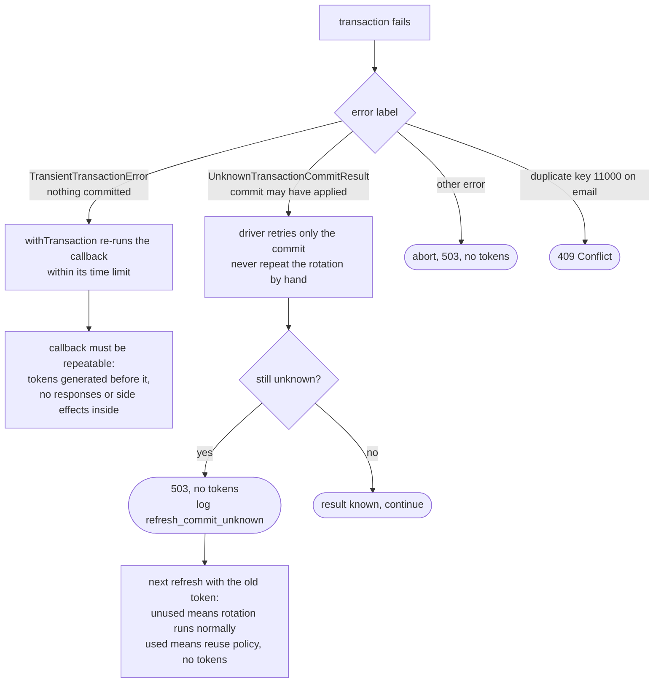

## 7. Sign up and sign in rules

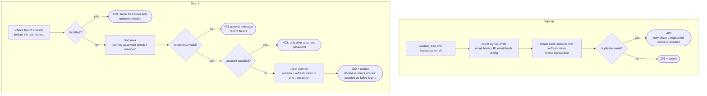

## 8. Refresh rotation

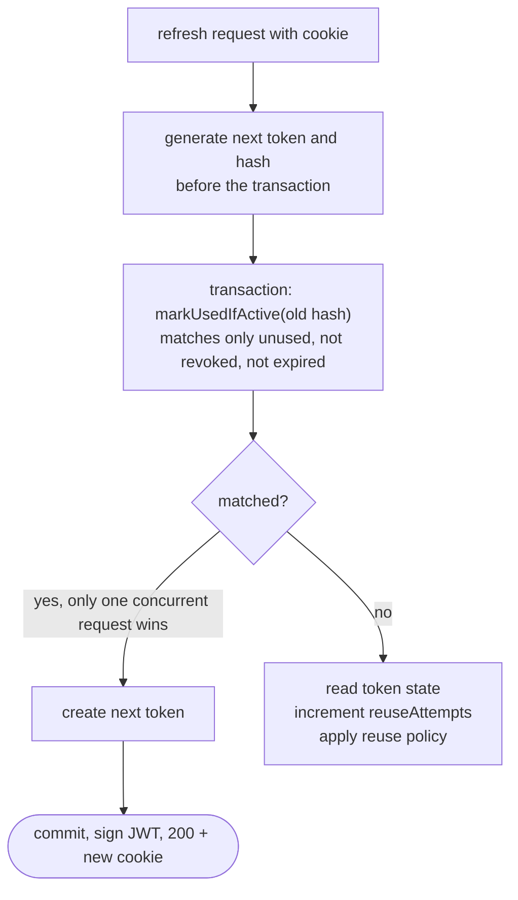

## 9. Refresh reuse policy

A used token never gets new tokens. Every presentation is logged as `refresh_reuse_attempt`.

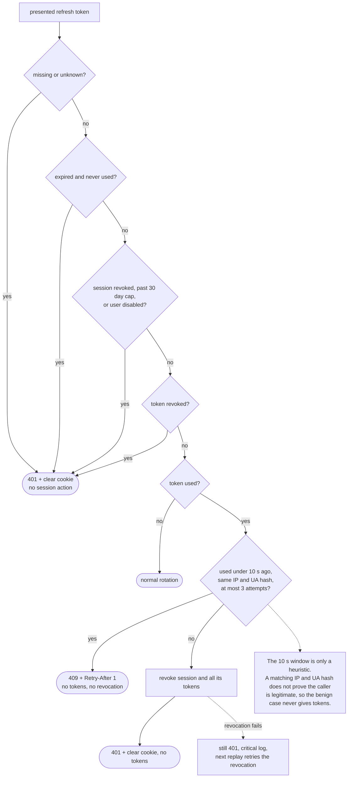

## 10. Logout authorization

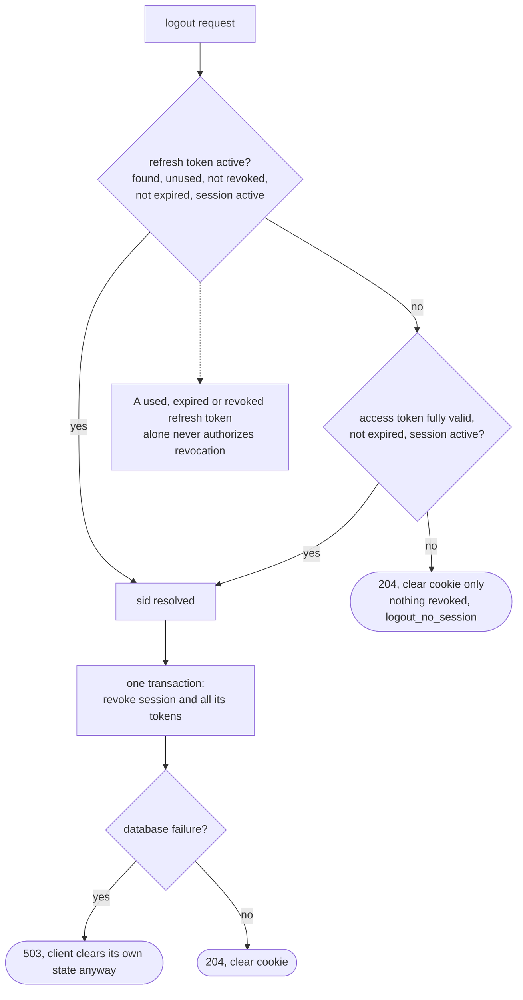

## 11. Rate limit store

```mermaid
flowchart LR
    call["hit(key, limit, windowSec)"] --> store{"strategy"}
    store -- "Redis" --> lua["one atomic Lua script<br/>increment, set TTL on first hit,<br/>return count and TTL"]
    store -- "Memory" --> mem["locked map<br/>same contract"]
    lua --> res["count + remaining TTL<br/>Retry-After comes from the TTL"]
    mem --> res

    keys["Key format<br/>rl:route:type:value<br/>value is IP, email hash, email hash + IP,<br/>sid or userId<br/>raw emails never stored"]
    fails["Sign-in failures<br/>counter + blockedUntil key<br/>delay 1, 2, 4 min, max 15"]
    down["Redis down<br/>sign up, sign in, logout, refresh fail closed 503<br/>per-user limit fails open"]
    call -.-> keys
    res -.-> fails
    store -.-> down
```

## 12. Frontend classes

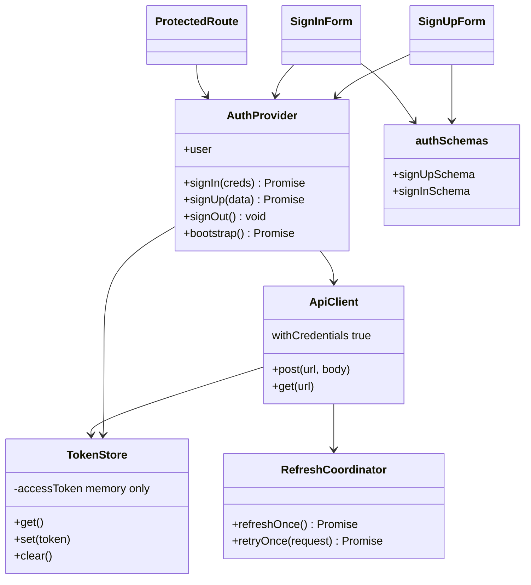

## 13. Frontend retry and lost response

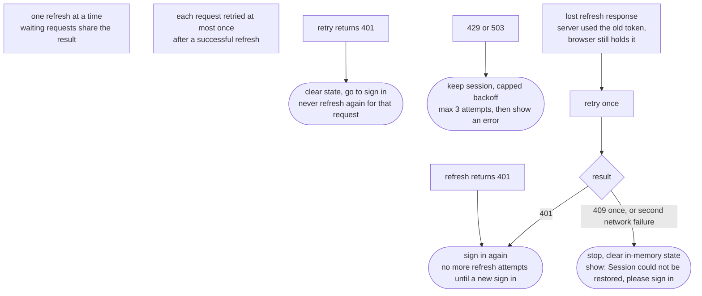

## 14. Folder layout

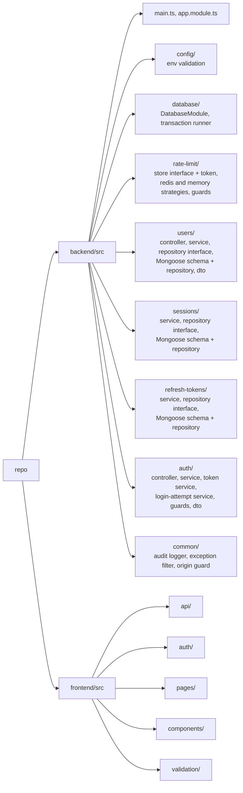
