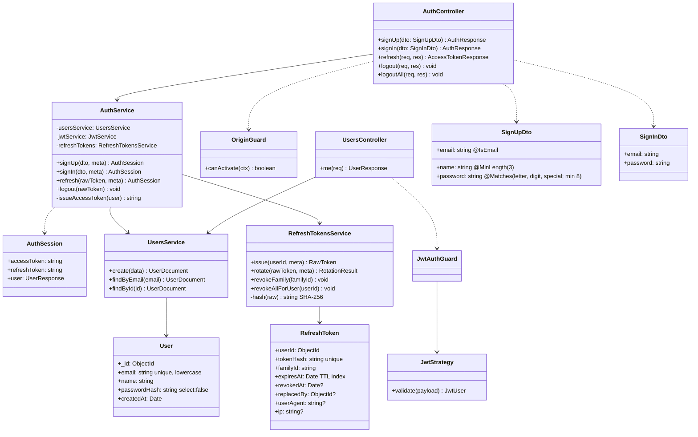
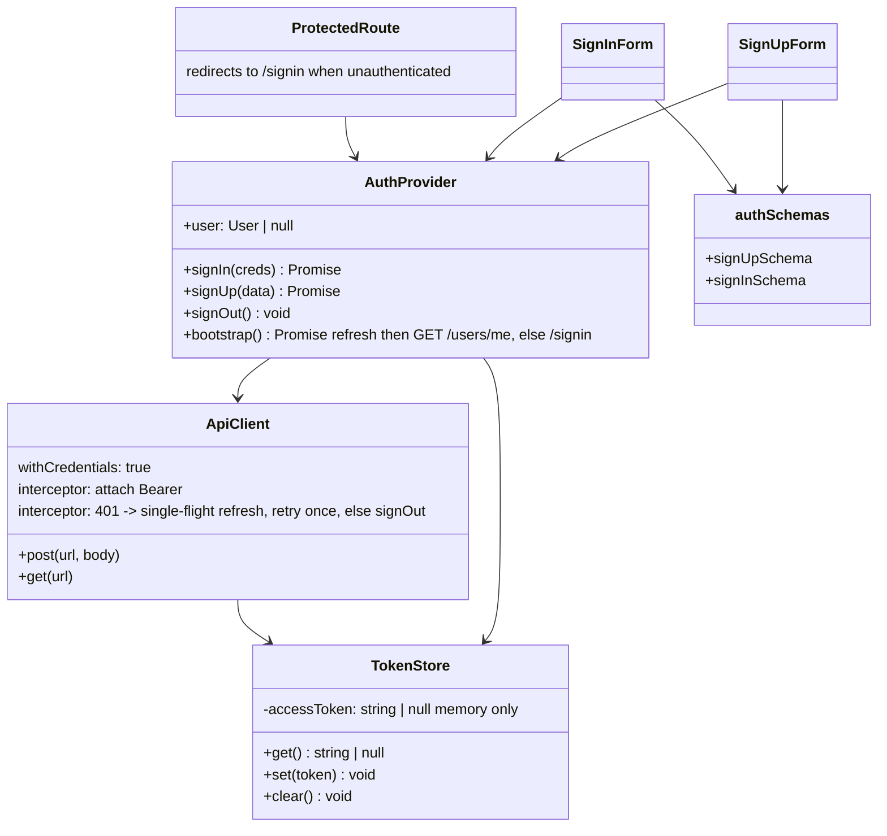

# C4 – Code-Level Design

## Backend classes



## Frontend modules



## Suggested folder layout

```
backend/src/{auth,users,refresh-tokens,common,config}/ , app.module.ts, main.ts
frontend/src/{api,auth,pages,components,validation}/ , App.tsx, main.tsx
```
