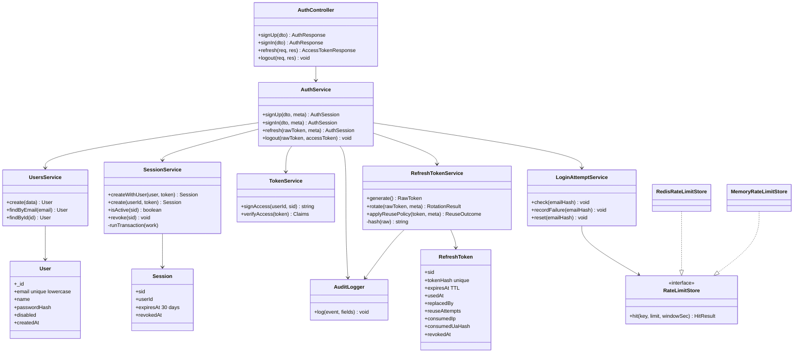
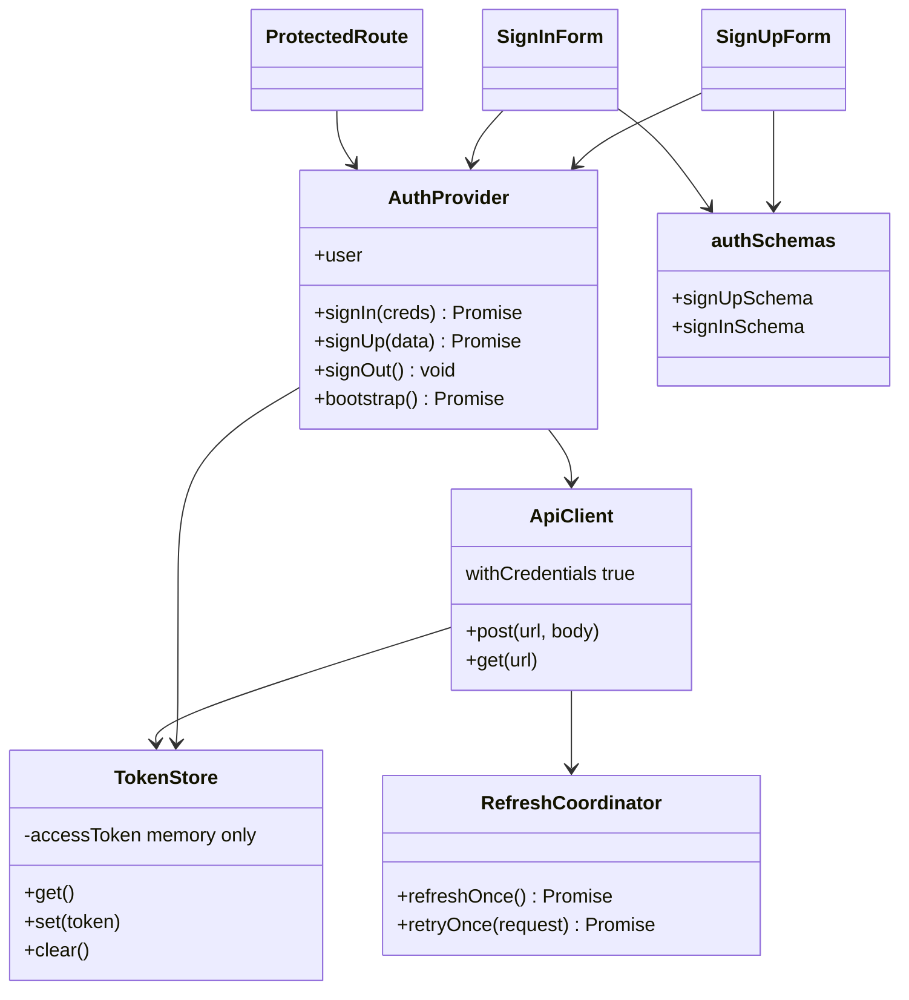

# C4 – Code-Level Design

## Backend classes



## Detailed rules

### Sign up and sign in
- Sign up: after validation and normalization (email trimmed and lowercased), count the signup limits (email hash + IP, and the email hash ceiling), then create user, session and first refresh token in one transaction. A duplicate key on email is a 409.
- Sign in: check the failure counter before the user lookup, so the 429 is the same for known and unknown emails. A dummy password check runs for unknown users. A disabled account returns 403 only after a correct password. Database errors are not counted as failed logins.
- Counters are incremented before the lookup, so a 409 is the only place an email registration is revealed. This is bounded by the signup limits.

### Refresh token creation
Generate the random 256-bit token first, hash it, store only the hash, send the raw value only in the cookie. Sign the access JWT only after the transaction commits.

### Rotation
In one transaction: conditionally mark the presented token as used (only if unused, not revoked, not expired), then insert the new token. Only one concurrent request can win.

### MongoDB transaction errors
| Error | Handling |
|---|---|
| `TransientTransactionError` | Nothing was committed. Retry the whole transaction, at most 2 times, then 503 |
| `UnknownTransactionCommitResult` | The commit may have applied. Retry only the commit, at most 2 times within a time limit. Never repeat the rotation. If still unknown, 503, no tokens, log `refresh_commit_unknown` |
| Other errors | Abort, 503, no tokens |

A later refresh with the old token either finds it unused (rotation runs normally) or used (reuse policy applies, no tokens).

### Refresh reuse policy
A used token never gets new tokens. Every presentation is logged as `refresh_reuse_attempt` (sid, ip, user agent hash, age, outcome).

| Presented token state | Session action | Response |
|---|---|---|
| Missing or unknown | None | 401 + clear cookie |
| Expired, never used | None | 401 + clear cookie |
| Session revoked, past 30 day cap, or user disabled | None | 401 + clear cookie |
| Revoked (for example by logout) | None | 401 + clear cookie |
| Used under 10 s ago, same IP and UA hash, at most 3 attempts | None | 409 + `Retry-After: 1`, no tokens |
| Used under 10 s ago but different IP or UA hash, or more than 3 attempts | Revoke session and all tokens | 401 + clear cookie |
| Used 10 s ago or more | Revoke session and all tokens | 401 + clear cookie |

The 10 s window is only a heuristic for concurrent tabs and lost responses. A matching IP and UA hash does not prove the caller is legitimate, so the benign case never gives tokens. If the revocation fails, the response is still 401, a critical log is written, and the next replay retries the revocation.

### Logout
Authorized only by an active refresh token (found, unused, not revoked, not expired, session active) or a fully verified, unexpired access token whose session is active. A used, expired or revoked refresh token alone never authorizes it. With no valid proof the server only clears the cookie (204, nothing revoked). Revocation is one transaction. A database failure returns 503, and the client clears its own state anyway.

### Rate limit store
- One atomic Lua script per hit (increment, set TTL on first hit, return count and TTL). `Retry-After` comes from the TTL.
- Keys: `rl:{route}:{type}:{value}`, value is IP, email hash, email hash + IP, `sid` or `userId`. Raw emails are never stored.
- Sign in failures use a counter plus a `blockedUntil` key (1, 2, 4 min, max 15 min).

## Frontend modules



### Frontend retry rules
- One refresh at a time. Waiting requests share its result.
- Each request is retried at most once after a successful refresh. If the retry returns 401, clear state and go to sign in. Never refresh again for that request.
- A 401 from refresh means sign in again, with no more refresh attempts until a new sign in.
- 429 and 503 keep the session and retry with capped backoff (max 3 attempts, then show an error).
- Lost refresh response: the server already used the old token and the browser still holds it. The frontend retries once. The server never issues tokens for a used token, so the outcome is a 409 or a 401. After one 409 retry, or a second network failure, stop, clear in-memory state and show "Session could not be restored, please sign in".

## Suggested folder layout

```
backend/src/{auth,users,sessions,common,config}/ , app.module.ts, main.ts
frontend/src/{api,auth,pages,components,validation}/ , App.tsx, main.tsx
```
