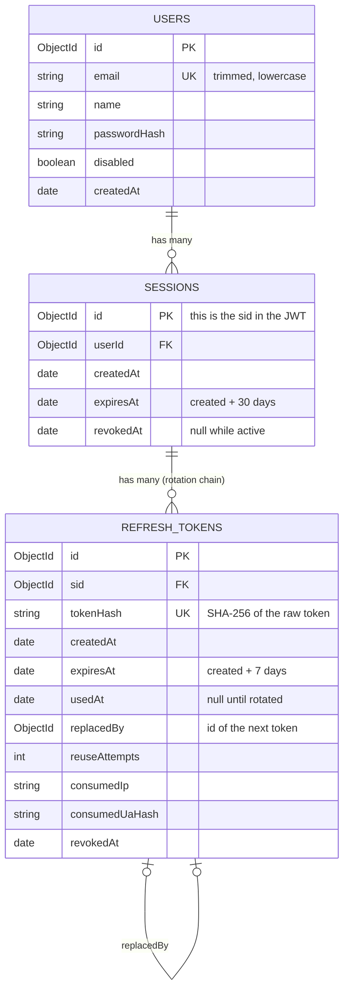

# Database Design (MongoDB + Mongoose)

Mongoose (through `@nestjs/mongoose`) is the data-access layer for MongoDB. MongoDB must run as a replica set, because transactions need one.

## Collections and relationships

## Rules

- `sid` is the session document's `_id`. No second identifier.
- A login creates one session. Each refresh consumes one token and creates the next, so a session has a chain of tokens.
- Rate-limit data is not in MongoDB. It lives in Redis only.
- MongoDB does not enforce foreign keys. Mongoose resolves no foreign keys for us, so the application must never delete a user or session and leave children pointing at it. Sessions and tokens are revoked (`revokedAt`), not deleted. Deletion is done only by TTL.
- Raw refresh tokens, raw emails in logs and plaintext passwords are never stored.

## Indexes

| Collection | Index | Purpose |
|---|---|---|
| users | `email` unique | One account per email. A duplicate-key error becomes 409 |
| sessions | `userId` | Revoke or list a user's sessions |
| sessions | `expiresAt` TTL (0 s) | Remove sessions after the 30 day cap |
| refresh_tokens | `tokenHash` unique | Lookup by presented token. The conditional update uses it |
| refresh_tokens | `sid` | Revoke all tokens of a session |
| refresh_tokens | `expiresAt` TTL (0 s) | Remove tokens after the 7 day expiry |

Indexes, including the TTL indexes, are declared on the Mongoose schemas (see below).

## TTL behavior

- MongoDB deletes a document some time after `expiresAt` (the TTL monitor runs about once a minute), so deletion is not exact.
- The code must always check `expiresAt` itself and never rely on TTL for security.
- Used and revoked tokens stay until their own `expiresAt`, so reuse can be detected during their lifetime. After expiry, a presented token is simply unknown (401, nothing revoked).
- Session TTL (30 days) is longer than token TTL (7 days), so tokens are removed first.

## Mongoose on MongoDB: points that affect the design

| Topic | Decision |
|---|---|
| Schemas | One Mongoose schema per collection, inside its feature module. Repositories use the injected models, nothing else does |
| Indexes | Declared on the schemas (`unique`, `index`, and `expires: 0` for TTL). Mongoose builds them with `autoIndex`. Turn `autoIndex` off in production and build them in a deploy step |
| IDs | Default `ObjectId` `_id`. `sid` is the session `_id` |
| Transactions | `connection.startSession()` and `session.withTransaction(fn)`. Requires a replica set. Every repository write receives the session through the optional `tx` |
| Conditional update | `updateOne({ tokenHash, usedAt: null, revokedAt: null, expiresAt: { $gt: now } }, { $set: ... }, { session })`. `modifiedCount === 1` means this request won the rotation |
| Write conflicts | Errors with the `TransientTransactionError` label: `withTransaction` re-runs the callback. The callback must be repeatable and free of side effects (generate tokens before it, no logging or responses inside) |
| Commit outcome | `UnknownTransactionCommitResult` label: `withTransaction` retries only the commit within its time limit. If still unknown, 503, no tokens, no repeat of the rotation (see `c4-code.md`) |
| Duplicate key | Error code 11000 on `email` maps to 409 |
| Reads | Use `lean()` for read paths that need plain objects, so Mongoose documents do not leak into services |
